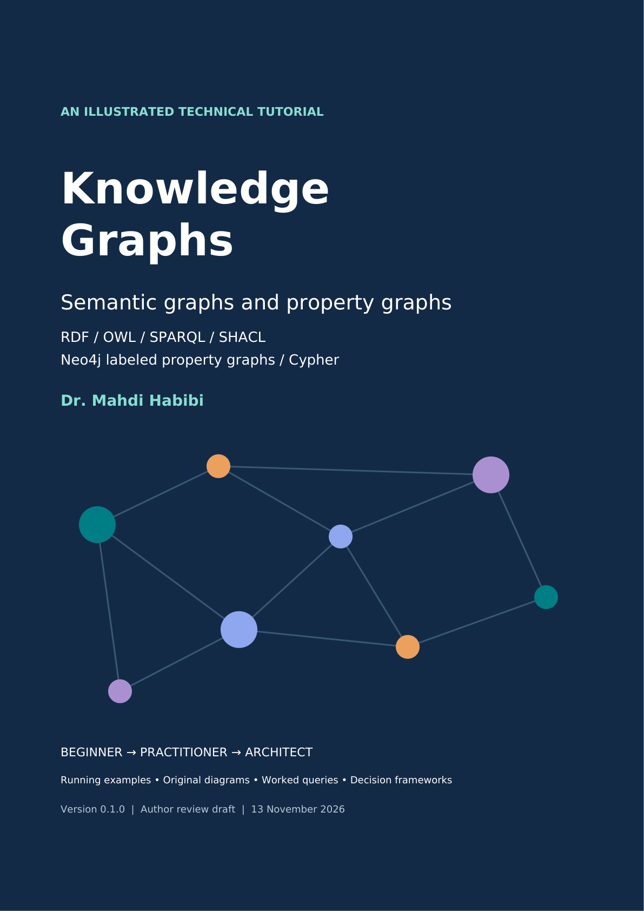

<h1 align="center">Knowledge Graphs:<br>Semantic Graphs and Property Graphs</h1>

<p align="center">
  <strong>Dr. Mahdi Habibi</strong><br>
  Version 0.1.0 · Author review draft
</p>

<p align="center">
  <a href="dist/knowledge-graphs-tutorial.pdf">
    
  </a>
</p>

<p align="center">
  <strong>One catalog. Two graph worlds.</strong><br>
  An illustrated, hands-on path from graph fundamentals to architecture and graph RAG.
</p>

<p align="center">
  <a href="dist/knowledge-graphs-tutorial.pdf"><strong>Read the PDF</strong></a> ·
  <a href="book/index.md">Browse the chapters</a> ·
  <a href="lab/README.md">Explore the lab</a> ·
  <a href="publication/VALIDATION.md">Validation evidence</a>
</p>

A practical learning path through RDF, RDFS, OWL, SPARQL, SHACL, labeled property
graphs, Neo4j, and Cypher, using one synthetic course-recommendation catalog.
Later parts cover event modeling, provenance, interoperability, architecture,
operations, graph RAG, and analytics.

## Start reading

- [Book PDF](dist/knowledge-graphs-tutorial.pdf)
- [Read the chapters in a browser](book/index.md)
- [Run the companion lab](lab/README.md)
- [See the actual validation results](publication/VALIDATION.md)
- [Publication and Zenodo plan](publication/PUBLISHING-GUIDE.md)

The intended audience begins with graph concepts. New terms are introduced by
the question they answer. Baseline data, isolated variations, model extensions,
and pseudocode are labeled separately. Each technical part has learning goals
and a short self-check.

## What has been checked

The RDF fixture runs six SPARQL queries, positive and negative SHACL cases,
controlled policy changes, and a small RDFS inference. The Neo4j fixture was
executed against Community 5.26.30: baseline queries, repeatable loading,
unmet-prerequisite exclusion, and multi-topic deduplication pass.
The separate [OWL 2 DL checker](lab/owl_dl/README.md) passed the Graduate and
Exercise 5 cases with HermiT, including profile checks and counterfactual controls.
See the validation report for precise scope and versions. These targeted results
do not verify every OWL example, production performance, concurrency, recovery,
or independently reproduce the Neo4j execution.

## Build the book

Requires Python 3.10+:

```sh
python3 -m venv .venv
.venv/bin/python -m pip install -r requirements-build.txt -r lab/requirements.txt
.venv/bin/python scripts/build_pdf.py
.venv/bin/python scripts/export_web.py
.venv/bin/python lab/check_rdf.py
.venv/bin/python scripts/check_package.py
```

On Windows use `.venv\Scripts\python`. Included, separately licensed DejaVu fonts
make the PDF build independent of private system-font paths. The build uses a
fixed source timestamp; the same sources, fonts, and pinned libraries are intended
to give reproducible output. Cross-platform byte equality is not asserted.

`book/manuscript.md` is the editable source. `=== Part | Title` marks sections;
`@diagram name` selects a vector illustration implemented in the renderer.
`book/chapters/` and `assets/figures/` are generated browser-friendly exports.

## Review and feedback

Use [CONTRIBUTING.md](CONTRIBUTING.md) to report an error or confusing step.
Sources, examples, figures, and validation boundaries are supplied so reviewers
can reproduce findings. See [the validation report](publication/VALIDATION.md)
for the checks performed and their scope.

## License proposal and citation

The author requested preparation of **CC BY 4.0 for book text and original
illustrations, with MIT for code**. These are proposed public-release terms;
this review package does not represent a completed public release or a final
license grant. See [LICENSE.md](LICENSE.md) and the proposal. Bundled font rights
remain governed by their included notices.

[CITATION.cff](CITATION.cff) contains a preliminary citation. No DOI, public
repository URL, ORCID, affiliation, journal acceptance, or peer-review status is
invented. Add real identifiers when a record and repository exist.
