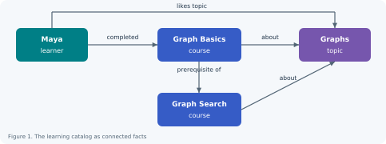
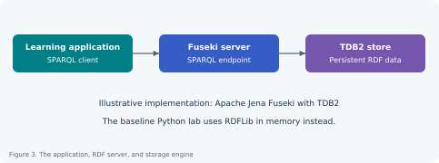
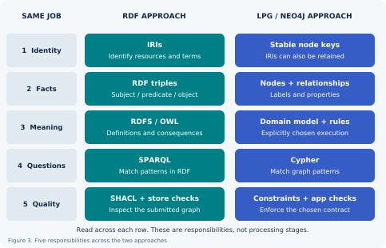
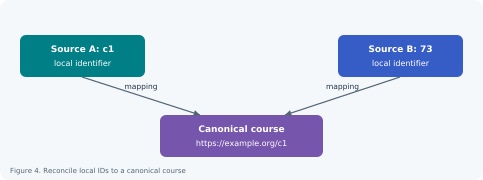

# I · Foundations

**Version 0.2.0 · Public review draft · Edition DOI: 10.5281/zenodo.24316420**

## 1.1 The running example and its questions

> **Learning goals for this part:** Explain the two graph representations in everyday language; distinguish a model, database, query language, meaning, and validation; trace each term back to the catalog.

### Meet Maya and the learning catalog
Imagine a learning application that helps people choose their next course. Maya, a fictional learner, likes the topic Graphs and has completed the course Graph Basics. She asks: **“What should I study next, and why?”** We will follow that question throughout the book. Keep these roles distinct: Maya is a person, Graph Basics is a course, and Graphs is a topic.

Our **learning catalog** collects the people, courses, topics, and completions needed to answer Maya. The table introduces its starting facts. Short IDs such as `c1` identify courses consistently even if their titles change.

| ID | What it identifies | Starting facts |
|---|---|---|
| maya / leo | Two people | Maya likes Graphs; Leo likes Data; both completed c1 |
| graphs / data / ethics | Three topics | Subject areas used to describe courses and interests |
| c1 | Graph Basics | 60 minutes; about Graphs; no recorded prerequisite |
| c2 | Graph Search | 90 minutes; about Graphs; requires c1 |
| c3 | Query Patterns | 75 minutes; about Data; requires c1 |
| c4 | Data Ethics | 45 minutes; about Ethics; no recorded prerequisite |

### What answer are we trying to produce?
A **prerequisite** is a course that must be completed before another course. For this example, recommend a course only when it matches a topic Maya likes, she has not completed it, and she has completed all its recorded prerequisites. This is an application **policy**: an explicit decision rule.

Under that policy, the answer is **c2, Graph Search**. It is about Graphs; Maya has not completed it; and she has completed its prerequisite, c1. c1 is excluded because she already completed it. c3 and c4 do not match her recorded interests.

### Questions that guide the model
A **competency question** is a concrete question a model must answer. Here we ask which courses match Maya's interests, whether prerequisites are satisfied, and which records support the explanation. These questions guide the definitions, diagrams, and queries.

For these exercises, treat the recorded prerequisite list as complete for each course. Later we will examine why that policy differs from knowing every fact in the world.

This starting dataset is the **baseline**. Later, we will add completion-event records and evidence documents as clearly marked extensions. They are not present in the baseline files. The next section turns this familiar story into a graph, one connection at a time.

## 1.2 A graph is a language for connections

### Turn the story into a picture
We have just met Maya and the learning catalog. Begin with one fact from that story: **Maya completed Graph Basics.** To draw it as a graph, place Maya in one box and Graph Basics in another, then connect them with an arrow labeled **completed**.

A **graph** consists of **nodes** (also called vertices) and **edges**, the connections between them. In this drawing, Maya and Graph Basics are nodes; the completed arrow is an edge. A **directed edge** has a start and an end. Reading Maya → completed → Graph Basics makes sense for our fact. Reversing that arrow would say that the course completed the person, which is a different and unintended statement.

### Add enough connections to answer the question
Now add Graph Search, the possible next course, and Graphs, the topic Maya likes. In the figure, boxes identify things; words beside arrows explain their connections. The arrow labeled “prerequisite of” goes from Graph Basics to Graph Search. It expresses the same requirement as “Graph Search requires Graph Basics,” read in the opposite direction.

Read the figure as five sentences: Maya completed Graph Basics; Maya likes Graphs; both courses are about Graphs; and Graph Basics is a prerequisite of Graph Search. Together, these facts explain why Graph Search is a candidate. The full eligibility policy will be written as queries later.

### Connect the vocabulary to this picture
An **entity** is a thing we identify: Maya is a person entity and Graph Basics is a course entity. An **attribute** describes an entity: the course's title is “Graph Basics” and its duration is 60 minutes. A **relationship** connects entities: the course is about the topic Graphs. We make Graphs an entity because many courses and learners can connect to the same topic.

A **path** is a sequence of connected steps; a **hop** is one step. Maya → Graph Basics → Graphs is a two-hop path. A **traversal** follows such connections from a starting node. A **join** combines matching information, for example by the same course ID. Engines may use either technique internally.

These are model concepts, independent of a particular database. We now need a way to represent this picture in a computer. The next section introduces the two approaches compared in this book before naming the tools around them. In this introductory figure, “label” simply means the words on an edge; later, a Neo4j node label has a more specific meaning.

## 1.3 Two approaches to the same graph

### From a picture to a computer representation
We have drawn the catalog and read its connections as sentences. Now imagine implementing the application. A computer needs a precise way to organize Maya, the courses, their attributes, and their connections. That organizing convention is a **data model**: a set of building blocks and rules for representing information.

This book compares two graph data models. The first is **RDF**, which represents information as statements about identified things. The second is the **labeled property graph**, which represents nodes and relationship instances with labels and properties. Both can describe our catalog and support the recommendation question. We will explain each in ordinary language before introducing its technical vocabulary.

### Approach 1: describe things with statements
Start with “Maya completed Graph Basics.” In the RDF approach, represent it as a three-part statement: the thing being described, the relation, and the related thing. In this case those parts are Maya, completed, and Graph Basics. A three-part statement is called a **triple**.

Other triples describe the same course: Graph Basics has title “Graph Basics”; Graph Basics has duration 60 minutes; Graph Basics is a Course. The statements connect through identifiers that consistently name the same person or course. An RDF database stores such statements, and other languages can describe their meaning, query them, or check them. We will introduce those languages in the next section.

### Approach 2: describe nodes and their connections
In a labeled property graph, make a node for Maya and a node for Graph Basics, then create a COMPLETED relationship from the first to the second. Give Maya's node a Person **label**, meaning a category marker. Give the course node a Course label. Store the course's title and duration as **properties**, meaning named values attached to that node.

A particular relationship can also have properties. If we later record a completion date, it can be attached to the completion relationship or represented through an event node when more history is needed. For now, keep the unchanged baseline: Maya completed c1, with no date or score added.

### What changes, and what stays the same?
| Question | RDF representation | Labeled property graph representation |
|---|---|---|
| How is the completion expressed? | An identified person, a completed predicate, and an identified course form a triple | A COMPLETED relationship connects the person node to the course node |
| How is duration expressed? | Another statement relates the course to the value 60 | A duration property on the course node has value 60 |
| What does the user learn? | Maya completed Graph Basics | Maya completed Graph Basics |

The domain fact stays the same. The organization of that fact changes. Neither choice alone decides which recommendation policy we use, whether source data is true, or how fast an implementation runs.

### Where Neo4j fits
**Neo4j** is database software that implements a labeled property graph and provides storage, queries, and operational features. RDF is a data model rather than one particular database product. Accordingly, our detailed comparison is between an RDF-based system and a Neo4j property-graph system. “RDF versus Neo4j” is a useful shorthand only after this distinction is clear.

Next we meet the tools around the RDF approach, one responsibility at a time. Then we do the same for the Neo4j approach, before aligning them in a comparison diagram.

## 1.4 Meet the RDF approach and its languages

### Why RDF comes with several names
The previous section showed how a triple records one fact. Building a useful application requires more than recording facts: we must identify things, describe categories, ask questions, and check submitted records. The RDF ecosystem names these jobs separately. This section introduces the names through the catalog needs they address; it is an orientation, not yet a syntax lesson.

### Record identified facts: RDF
**RDF** means **Resource Description Framework**. A resource is something we describe, such as Maya, c1, or a topic. RDF organizes descriptions as triples. The three parts have names: **subject** for the described thing, **predicate** for the relation, and **object** for the related thing or value. In “c1 is about Graphs,” c1 is the subject, about is the predicate, and Graphs is the object.

An identifier must distinguish the topic Graphs from an unrelated thing with the same display name. RDF uses **IRIs**, Internationalized Resource Identifiers, to name resources and predicates. An example is `https://example.org/c1`. Think of it here as a stable, globally scoped name; the identity section will explain why a name that looks like a web address is different from a text value. [[1](xii-references.md#ref1)]

### Describe categories and simple hierarchies: RDFS
The catalog tells us that c1 is a Course. Suppose we also want the general definition “Every Course is a LearningResource.” A **class** names a category, and a **subclass** is a more specific category contained within another. LearningResource is the general category in this example; Course is the more specific one.

**RDFS**, RDF Schema, supplies terms for these basic category and property relationships. With the relevant reasoning enabled, the course fact and subclass definition support the conclusion that c1 is a LearningResource. This is a first example of **inference**: deriving a conclusion from supplied facts and definitions. It does not require manually adding that broader category to every course record. [[11](xii-references.md#ref11)]

### Express richer logical definitions: OWL
A hierarchy is not enough for every definition. Suppose we want to define a category through relationships its members have, or declare that two categories cannot share a member. **OWL**, the **Web Ontology Language**, offers a formal language for such commitments. An **ontology** is the explicit domain model containing those concepts, relations, and, when formalized, logical statements called **axioms**.

OWL is not itself a database or an algorithm. A **reasoner** is software that computes the conclusions permitted by the selected semantics. We will study the difference between definitions and algorithms later; for this first map, associate OWL with the question “What do our definitions logically imply?” [[3](xii-references.md#ref3)]

### Ask questions about the facts: SPARQL
Our application needs to ask “Which courses are about Graphs?” and eventually “Which course is eligible for Maya?” A **query language** provides precise notation for such questions. **SPARQL**, whose recursive expanded name is SPARQL Protocol and RDF Query Language, is the query language used in the RDF chapters. It matches patterns in RDF data and returns answers. Merely writing a SPARQL query does not turn on every possible OWL inference. [[4](xii-references.md#ref4)]

### Check submitted records: SHACL
A course import might omit duration. We need to ask whether that submitted record satisfies our acceptance rules. **SHACL**, the **Shapes Constraint Language**, expresses checks such as “a Course must have one positive integer duration.” A **shape** is a collection of conditions applied to selected data. Validation compares the supplied graph with those conditions and reports violations. [[5](xii-references.md#ref5)]

Notice the difference in purpose: a definition can say that a Course is a LearningResource; a check can say that an incoming Course record lacks its required duration. We need both ideas, but they answer different questions.

### Keep only the names attached to the jobs
RDF records statements; RDFS and OWL describe meaning; SPARQL asks questions; SHACL checks supplied data. These are separable capabilities. A system may use RDF and SPARQL without using OWL, and a SHACL check is not automatically installed as a database write constraint.

You do not need to memorize syntax yet. The detailed chapters return to each job with executable or carefully scoped examples. Next we introduce the property-graph vocabulary with the same discipline, so the later comparison has two understandable sides.

## 1.5 Where the RDF database fits

### The question left by the language map
We have named RDF, RDFS, OWL, SPARQL, and SHACL. Which of those stores the graph? None is the name of a particular database product. RDF specifies the data model; the other names identify languages or standards used around that model. A software system must still store data and execute requests.

### The database category: RDF store or triplestore
An **RDF store**, often called a **triplestore**, stores and queries RDF statements. These are categories of database software, just as “relational database” is a category. They do not identify one specific product.

A **persistent store** retains data beyond the lifetime of the process that loaded it, usually using disk storage and recovery mechanisms. An **in-memory graph** keeps its working data in process memory. A library may offer different storage backends; which one we instantiate determines the behavior. Neither the RDF model nor the SPARQL language alone promises persistence.

### A concrete implementation: Jena TDB2 with Fuseki
To attach real names to the roles, consider **Apache Jena**, a software framework for RDF. Its **TDB2** component provides RDF storage and query on a single machine. **Fuseki** is a SPARQL server that can expose a dataset to client applications and work with a persistent storage layer. Thus TDB2 is a storage-engine name and Fuseki is a server name within this example stack. [[33](xii-references.md#ref33), [34](xii-references.md#ref34)]

A **SPARQL endpoint** is an address to which a client sends a query and from which it receives results. The endpoint is the service interface; it is not another name for RDF itself. **Client** here means the program asking the question, such as our learning application.

### Read the implementation diagram by role
In the figure below, the application sends a question to the server. The server evaluates the question using the stored RDF dataset and returns results. The arrows follow the query path; results return along the reverse route. This drawing describes one example implementation. OWL reasoning and SHACL validation are separate capabilities to configure; their presence is not implied simply by drawing a database box.

This is an illustrative implementation, not the database used by the baseline lab and not a recommendation that it is best for every project. For an optional alternative framework, see the RDF4J repository documentation in reference [[35](xii-references.md#ref35)]; no additional product names are needed to follow this example.

### What the companion lab actually runs
Our executable RDF exercise uses **RDFLib**, a Python library, with an in-memory Graph object. It reads catalog.ttl, runs SPARQL queries locally, and uses separate validation and inference libraries for the stated checks. It does not start Fuseki, TDB2, RDF4J Server, or another database server. Passing it verifies the small fixture's behavior in that environment, not a deployed store's scalability or transaction guarantees.

The comparison is therefore RDF data model + a chosen RDF implementation + SPARQL, alongside LPG data model + Neo4j + Cypher. The next section introduces the latter stack. Keeping model, library, storage engine, server, and query language distinct will make the rest of the book easier to follow.

## 1.6 Meet labeled property graphs and Neo4j

### Rebuild the same fact using nodes
The RDF orientation separated statements, meaning, questions, and checks. We now return to “Maya completed Graph Basics” and introduce the second approach's building blocks. This is still the same catalog; only its representation is changing.

A **labeled property graph**, abbreviated **LPG**, contains nodes, directed relationship instances, and properties. “Labeled” refers to category markers on nodes. “Property” refers to named stored values. In our example, Maya's node has the label Person; the Graph Basics node has the label Course.

### Labels, relationship types, and properties do different jobs
A **node label** answers “Which category does this node belong to?” Course and Person are examples. A **relationship type** answers “What kind of connection is this?” COMPLETED connects Maya to a course, while ABOUT connects a course to a topic. Capitalization here is a naming convention used by the examples.

A **property** answers “Which value is stored on this node or relationship?” The course node can have an id property with value c1, a title property with value Graph Basics, and a durationMinutes property with value 60. A property key is the name of the field; its value is the stored content. The topic Graphs remains a separate node because many people and courses can connect to that same topic.

A node may have more than one label. A relationship is a particular connection between two nodes, so repeated occurrences can be represented separately. Whether a completion should be one relationship or an independently identified event is a domain-modeling decision that we will revisit later.

### The database is Neo4j; the query language is Cypher
**Neo4j** is the database system used to store and operate this graph in our second route. **Cypher** is the query language used to ask it questions. A **declarative** query describes the matches or results wanted, while the database chooses how to execute the request.

For example, the question “Find Course nodes connected by ABOUT to the Graphs topic” describes a pattern to match. Cypher supplies notation for that pattern. The later code chapter teaches its parentheses, arrows, variable names, and clauses; none of those symbols is needed to understand the model here. [[6](xii-references.md#ref6), [20](xii-references.md#ref20)]

### Where meaning and quality come from
A label named Course is useful, but its name alone does not define what counts as a course or whether course categories inherit from one another. The team must record those meanings in its domain model and choose how any additional rules run. Ontologies can guide a property-graph design too; storing an ontology does not automatically execute OWL reasoning.

For quality, a database **constraint** can enforce a supported storage rule, such as preventing two Course nodes from using the same id value. An application or import pipeline can perform additional checks, such as requiring a valid duration or rejecting a prerequisite cycle. The available native constraints depend on the chosen database version and edition. [[7](xii-references.md#ref7)]

### We now have two sets of names for comparable jobs
In the first route, RDF represents facts and SPARQL queries them. In the second, an LPG represents facts and Cypher queries them in Neo4j. Both also need identity, meaning, and quality policies. The next section aligns those responsibilities visually; it introduces no new programming syntax.

## 1.7 Separate the five layers

We have now introduced both approaches and the main names associated with each. We can finally compare them without treating every name as the same kind of thing. Return to Maya's recommendation: a working system must identify her courses, represent connections, interpret them, answer a question, and check the records it accepts.

### What “five layers” means here
A **layer** in this comparison is one responsibility of the system. The five responsibilities are identity, representation, meaning, querying, and quality. They are a teaching framework, not five servers and not a required sequence of processing steps. A single database may address several of them; several tools may cooperate on one of them.

### 1 · Identity: which thing are we referring to?
Every mention of c1 must refer to the same intended course. RDF uses IRIs as resource identifiers. A Neo4j application usually chooses stable node keys and can also retain IRIs. In either case, we must decide when two source records identify the same course. Neither naming convention makes that decision for us.

### 2 · Representation: how are the facts organized?
RDF represents “Maya completed c1” as a subject–predicate–object triple. The LPG represents it as a relationship between nodes, with category labels and properties describing the nodes. This is the data-model comparison. It is separate from the choice of database software that stores and executes the model.

### 3 · Meaning: what do the terms commit us to?
Suppose we say that every Course is a LearningResource. In an RDF-based system, RDFS or OWL can express that meaning with standardized logical consequences. In an LPG application, definitions and any executable rules must also be specified; a Course label alone does not install inheritance or OWL reasoning. Both approaches can use an ontology, but the runtime behavior must be explicit.

### 4 · Querying: how do we ask for the answer?
“Which course can Maya study next?” is our query problem. The RDF route uses SPARQL; our Neo4j route uses Cypher. Both can express the catalog policy. Query syntax and a graph data model are different layers: knowing how a fact is represented is not yet the same as knowing how to ask for it.

### 5 · Quality: which submitted records are acceptable?
A course record without duration may violate our data contract. SHACL can check an RDF graph against that condition. Neo4j constraints and application or pipeline checks can enforce the supported rules in the LPG route. We must also specify when a check runs and whether a failure blocks publication, rejects a write, or produces a report.

### How to read the comparison diagram
The diagram below is a **map of responsibilities**, not a data-flow chart. The left column names one of the five jobs. The middle column shows the RDF-side mechanism already introduced; the right column shows the LPG/Neo4j-side mechanism. Read across one row to compare the same job, then move to the next row. There are no arrows because the drawing does not prescribe an execution order.

For example, read the querying row as “use SPARQL in the RDF route, or Cypher in this LPG route.” Read the quality row as a separate question about checking data. OWL appears in the meaning row because interpreting definitions is different from rejecting an incomplete submitted record.

### The comparison this prepares us to make
RDF and LPG are data models; SPARQL and Cypher are query languages; OWL and SHACL address different semantic and validation needs; Neo4j is database software. When someone says “RDF versus Neo4j,” clarify that the architectural choice is between complete candidate systems with these responsibilities assigned.

The later comparison chapters assess those systems against workload, governance, and operational requirements. At this stage we are only building the map needed to read them. Next we clarify the word schema, which is used for more than one of these responsibilities, and then establish the catalog's identity policy. [[1](xii-references.md#ref1), [3](xii-references.md#ref3), [5](xii-references.md#ref5), [6](xii-references.md#ref6), [8](xii-references.md#ref8)]

## 1.8 What schema means in each approach

### One word, three different questions
The five-layer map separates meaning, quality, and execution. The word **schema** can refer to artifacts in any of these areas, which can make discussions confusing. Before continuing, distinguish the question being asked whenever someone says “Does this graph have a schema?”

### A conceptual schema explains the domain
A **conceptual schema** describes the kinds of things in the domain and what their relationships mean. In our catalog, Person, Course, Topic, completed, and requires belong to that model. An ontology can make some of those definitions formal. A property-graph application also has a conceptual schema, even if its database did not require one to be declared before loading nodes.

### A validation schema describes acceptable submissions
A **validation schema** states what a submitted record must contain or satisfy. “Every Course record must have one positive integer duration” is such a rule. A SHACL shape is one way to express it for RDF. Supported database constraints and additional application checks can cover acceptance rules in the LPG route.

This schema answers whether the supplied record meets the contract; it does not, by itself, prove that the recorded duration is correct in the world. A course can have a well-formed but inaccurate value.

### A physical schema supports execution
A **physical schema** concerns how a database supports storage and access, such as indexes. An **index** is a lookup structure that can help find a node or statement by a selected value. For example, looking up course id c1 efficiently is an execution concern. Creating that index does not define what Course means or prove that c1 has a valid duration.

### Separate a standard from its implementation
A **standard** specifies agreed syntax or behavior. An **implementation** is software that realizes some part of it. RDF and its supporting standards can be implemented by different databases; those databases need not have identical indexes, transaction behavior, or reasoning support. Similarly, the abstract LPG model is distinct from the particular features of a Neo4j release.

We will keep these senses separate in the detailed chapters. First, however, both approaches need the same foundation: a reliable way to identify the course and learner mentioned by each fact.

## 1.9 Identity before intelligence

The catalog table gave Graph Basics the ID c1. Before encoding that fact in either graph model, we need to explain why the ID matters: every completion and prerequisite must refer to the correct course, even after a rename or an import from another source.

### A name is not an identifier
Two courses can share a title. One course can change its title. Treating the title as identity creates accidental merges and broken links. Use a stable **key**, a value selected to distinguish records within a defined scope. A **canonical identifier** is the preferred identifier after reconciliation across sources.

In the figure, two independent source catalogs use local IDs c1 and 73 for the same course. Mapping both records to a canonical identifier is a reviewed identity decision; matching the strings alone would not establish it.

An **IRI**, or Internationalized Resource Identifier, is a globally scoped identifier syntax. In RDF, `https://example.org/c1` identifies a resource; the text literal `"https://example.org/c1"` is a string value. These are different RDF terms. An IRI need not resolve to a web page to be a valid graph identifier, although publishing useful descriptions is often helpful. [[1](xii-references.md#ref1)]

### An identity policy for the catalog
Use `https://example.org/c1` for the abstract course and separate IDs for editions when prerequisites or assessment rules differ. Store source keys in a mapping table with a source namespace. Retain the evidence and date of every merge decision. Do not generate a new ID because a title was corrected.

In Neo4j, store a unique application key such as `id: 'c1'`; an additional `iri` property can preserve cross-system identity. Database-internal identifiers are implementation details and should not be your durable integration contract. Global identifiers are possible in a property graph; RDF simply makes them fundamental to the data model.

### Entity resolution is a decision process
**Entity resolution** determines whether records describe the same real-world thing. **Deduplication** removes redundant representations after that decision. Similar titles or close embeddings (numeric vectors used for similarity comparison, introduced in Chapter 8) are useful evidence, not proof. Distinguish exact identity from related editions, translations, or approximate matches. A false merge can propagate incorrect prerequisites and recommendations throughout the graph.

> Keep source identity, canonical identity, and display names separate. Correct identity is often more valuable than a sophisticated graph algorithm.

### Connection to the next part
We now know the story, the graph vocabulary, and the identity policy. The next part uses RDF to write the catalog as statements without changing what the learner and course IDs refer to.

### Check your understanding
**Try first:** core questions for this chapter are 1, 3, 4, 6, 7, 9, 10, 13, 16. They cover its main concepts and application decision. Attempt the remaining questions as a second pass. Cover the next answer with a sheet or scroll it out of view while writing your prediction. Compare the explanation only after committing an answer.

These questions revisit the whole Foundations part, from Maya's catalog to the five responsibilities and identity policy. Try answering each question before reading its answer. Explain your answer using the catalog rather than relying only on a memorized definition. No query syntax is required yet.

### Review 1 · Read the graph and the recommendation
**Question 1: In “Maya completed Graph Basics,” what are the nodes, the connection, and its direction?**

**Answer:** Maya and Graph Basics are the nodes. The completed connection goes from Maya to Graph Basics. Read the start, connection name, and end together as a sentence. Reversing the same named connection would say that Graph Basics completed Maya, which changes the meaning. To express the original fact in the opposite direction, the connection would need a different name, such as “was completed by.”

**Question 2: Why do we represent Graphs as a topic entity but keep 60 minutes as a course attribute?**

**Answer:** Graphs is something that several courses and learners connect to: a course is about Graphs, and Maya likes Graphs. Giving the topic its own identity lets those connections meet at the same thing. In the starting model, 60 minutes simply describes a course's duration. This is a modeling choice guided by the questions we need to answer; it is not a rule that every word must become a node or every number must remain an attribute.

**Question 3: How many hops are in the path Maya → Graph Basics → Graphs, and what does that path establish?**

**Answer:** There are two hops: one from Maya to the course she completed, then one from that course to its topic. The path establishes that Maya completed a course about Graphs. It does not, by itself, establish that she likes Graphs; the catalog records her interest through a separate likes connection. A connected path must be interpreted through the meaning of each connection.

**Question 4: Why is Graph Search, c2, the baseline recommendation for Maya?**

**Answer:** Our policy requires a matching interest, an uncompleted course, and completion of every recorded prerequisite. c2 is about Graphs, which Maya likes; she has not completed c2; and she has completed c1, its prerequisite. c1 fails the uncompleted condition. c3 and c4 fail the matching-interest condition. The result follows from both the recorded facts and our stated policy, not from the graph shape alone.

**Question 5: What is a competency question, and how does it help us choose what to store?**

**Answer:** A competency question states something the model must be able to answer, such as “Has Maya completed every prerequisite of this candidate course?” That question tells us we need learner completions and course prerequisites, with identifiers that let us connect them. It also reveals a completeness assumption: in this exercise, we treat each recorded prerequisite list as complete. If required facts are missing, changing the database product alone cannot repair the answer.

### Review 2 · Put each technology in its place
**Question 6: Is RDF the name of the database server? Where is the database in the RDF approach?**

**Answer:** No. RDF is the data model for representing statements. An implementation stores and queries those statements. For example, an RDF stack can use TDB2 for persistent storage and Fuseki to expose a SPARQL service. Our small lab instead uses RDFLib, a Python library, with a graph held in memory; it starts no separate database server. Distinguish the model, the selected storage implementation, and any server that provides access to it.

**Question 7: Why does “RDF versus Neo4j” need clarification?**

**Answer:** RDF is a data model, whereas Neo4j is a database system implementing a labeled property graph. To compare representations, compare RDF with the LPG model. To compare working systems, compare a chosen RDF implementation and its configuration with a chosen Neo4j implementation and its configuration. Otherwise, a model's possibilities can be confused with a particular product's implemented features.

**Question 8: What do SPARQL and Cypher do, and do they decide the recommendation policy for us?**

**Answer:** They are query languages: SPARQL is used in our RDF route, and Cypher in our Neo4j route. We use them to express questions and retrieve matching results. The application designer still chooses the policy, such as requiring all recorded prerequisites. A query can express the wrong policy precisely, so we must check that its meaning matches the intended question.

**Question 9: Which tools address meaning, and which address acceptance checks?**

**Answer:** RDFS and OWL can express formal meaning, such as every Course being a LearningResource. A configured reasoner can derive the consequences supported by those definitions. SHACL can check whether submitted RDF data meets a condition, such as requiring a positive integer duration. In our LPG route, supported Neo4j constraints and application or pipeline checks cover acceptance rules. These jobs cooperate, but deriving a category and checking a record are different tasks.

**Question 10: Is an ontology an algorithm, and can a property-graph application use one?**

**Answer:** An ontology describes the domain's concepts, relationships, and definitions; a formal ontology can include logical axioms. It is not an algorithm. An algorithm is a procedure for carrying out a computation. A property-graph application can use an ontology to guide its labels, relationships, and documented meanings. However, a Course label or a stored ontology does not automatically make Neo4j execute OWL reasoning; the chosen runtime must provide any required reasoning behavior explicitly.

### Review 3 · Separate responsibilities and protect identity
**Question 11: What are the five responsibilities, and are they five mandatory servers?**

**Answer:** They are identity, representation, meaning, querying, and quality. For c1, they ask: which course is this; how are its facts organized; what does Course mean; how do we retrieve answers; and which records are acceptable? They are a way to separate design questions, not a required deployment arrangement or processing order. One component can serve several responsibilities, and several components can cooperate on one responsibility.

**Question 12: What is the difference between a conceptual model, a validation schema, and a physical schema?**

**Answer:** A conceptual model defines the domain, such as learners, courses, topics, and completions. A validation schema describes acceptance conditions, such as requiring a positive integer duration. A physical schema supports storage and access, for example through an index on a course identifier. An index may speed up a lookup, but it does not define Course or establish that a duration is valid. Always ask which sense of “schema” is intended.

**Question 13: If Graph Basics is renamed, should c1 receive a new identifier? What if another course has the same title?**

**Answer:** A title correction or rename does not, by itself, change the course's identity, so the stable identifier stays the same. A different course may share that title and still need a different identifier. This is why completion and prerequisite links should refer to stable course identifiers rather than display titles. A materially different course edition may need its own identity under the catalog's stated policy.

**Question 14: Is the IRI https://example.org/c1 the same RDF term as the string “https://example.org/c1”? Must the IRI open a web page?**

**Answer:** No. Used as an IRI, it identifies a resource; used as a string literal, the same characters are a text value. Their roles in RDF differ even though the displayed characters match. An IRI does not have to resolve to a web page to be a valid identifier. Providing a useful description at that address can help users, but identification and web retrieval are separate concerns.

**Question 15: Two source catalogs use c1 and 73 for courses with the same title. Can we merge them immediately?**

**Answer:** No. Matching titles are evidence to investigate, not proof of identity. Entity resolution determines whether the records refer to the same intended course, using appropriate evidence such as edition, provider, or content. After that decision, deduplication can remove redundant representations, and a canonical identifier can connect the source records. Preserve the source identifiers and the evidence behind the decision so the mapping can be reviewed.

**Question 16: A course passes every configured validation check. Does that prove its facts are true or that the system will scale?**

**Answer:** No. A positive integer duration can satisfy a shape while still being inaccurate in the real world. Likewise, a passing in-memory exercise establishes behavior only for the tested data, software, and checks. It does not establish production throughput, durable storage, or deployment guarantees. Ask what each check actually measured before drawing a broader conclusion.

### Apply the foundations to one new requirement
**Question 17: Preview — revisit after Section 5.1. The application must now keep the date of each completion and allow the same learner to complete a course more than once. What should you decide before writing a query?**

**Answer:** First clarify what counts as a distinct completion and how its date and identity are recorded. A bare “Maya completed c1” connection does not explain how to distinguish repeated occurrences. An LPG can use separate relationship instances with properties, or an event node when the completion needs its own identity and further connections. An RDF model can introduce an identified completion event with links to the learner, course, and date. These are possible extensions, not facts already present in our baseline. We will develop event modeling later; the lesson here is to settle the meaning and identity of the new information before choosing query syntax.

**Ready to continue:** You should now be able to explain the catalog to another reader, place each technology in the correct role, and distinguish a stored fact from a definition, a policy, and a validation rule. If a question was difficult, revisit the corresponding Foundations section before beginning the RDF syntax chapter.
