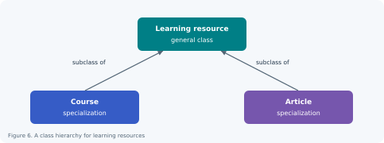
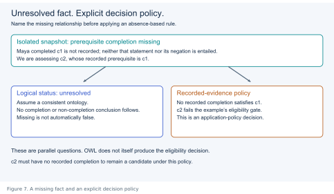
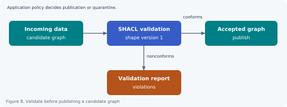

# II · RDF and semantic graphs

## 2.1 RDF statements, terms, and datasets

> **Learning goals for this part:** Read a triple and a Turtle fragment; separate RDFS/OWL consequences from SHACL acceptance checks; explain what a missing fact does and does not imply.

We will now encode the catalog using the first approach, RDF. Keep the simple fact “c1 is about Graphs” in mind: the goal is to turn that connection into a precisely identified statement. This section introduces the pieces needed to read the first RDF fragment.

### The triple
RDF means **Resource Description Framework**. In RDF 1.1, a triple has a **subject**, a **predicate**, and an **object**. The subject identifies what is described; the predicate identifies the relationship or attribute; the object is the related resource or value. An RDF graph is a set of triples, so adding an identical triple twice does not create two statement occurrences. [[1](xii-references.md#ref1)]

**Worked fragment — describe one course.** This is an isolated syntax example, not the complete catalog. We use the prefix `ex:` as a short form of `https://example.org/`; consequently, `ex:c1` names c1, Graph Basics, and `ex:graphs` names the Graphs topic. The title is language-tagged here to introduce that notation; the later baseline uses plain string titles.

Before reading this first Turtle block, use this symbol key. Section 2.2 will practice its abbreviations.
- @prefix declares an abbreviation; angle brackets enclose a full IRI. Thus ex:c1 expands to https://example.org/c1.
- xsd abbreviates XML Schema's datatype namespace, used here for integer values.
- Quotation marks surround literal text. The ^^ marker attaches a datatype; @en supplies an English language tag.
- A semicolon means same subject, next predicate; a final period ends the group of statements.

```turtle
@prefix ex: <https://example.org/> .
@prefix xsd: <http://www.w3.org/2001/XMLSchema#> .

ex:c1 ex:title "Graph Basics"@en ;
      ex:durationMinutes "60"^^xsd:integer ;
      ex:about ex:graphs .
```

Read the fragment as three statements about c1: its title is “Graph Basics” in English, its duration is 60 minutes, and it is about Graphs. Here `ex:c1` is the subject of three triples. `ex:title` and `ex:about` are predicates. The title and duration are **literals**, value terms that each have a datatype. A language-tagged string also has a language tag and datatype `rdf:langString`. `ex:graphs` is an IRI naming a topic. `xsd:integer` names an integer datatype. `"60"` is a string; `"60"^^xsd:integer` is an integer-typed literal.

### Three kinds of RDF term
An **IRI** names a resource. A **blank node** represents a resource without assigning a global IRI; its local identifier is not a portable business key. A **literal** represents a value. Under RDF 1.1, subjects are IRIs or blank nodes, predicates are IRIs, and objects may be any of the three term kinds. [[1](xii-references.md#ref1)]

### Graphs versus datasets
An **RDF dataset** contains a default graph and zero or more **named graphs**. A named graph associates a graph name with a graph. A stored statement with its graph name is often called a **quad**. Naming a graph does not itself prove its author, truth, or access permissions; you must define those conventions.

> The triple is the logical unit. A triplestore is a database designed to store and query RDF; a quadstore also exposes graph organization. Neither term specifies the complete operational behavior of a product.

## 2.2 Turtle, JSON-LD, and reading syntax

The previous section explained what an RDF statement means. Now we look at how to write the same kinds of statements in text. We will compare a readable Turtle fragment with a JSON-LD fragment, while keeping separate the text format and the graph it represents.

### Serialization is not a different graph model
A **serialization** is a textual representation of a data model. We first use **Turtle**, a readable text notation for RDF statements. The following example teaches its abbreviations. Later in this section we use JSON-LD to show another text representation. Changing serialization does not necessarily change the graph; changing the statements does. [[9](xii-references.md#ref9), [10](xii-references.md#ref10)]

**Isolated Turtle variation.** To demonstrate comma notation, this fragment gives c1 two topics, Graphs and Data. The baseline later gives c1 only Graphs. Do not carry this extra Data connection into the baseline queries.

```turtle
@prefix ex: <https://example.org/> .
@prefix rdf: <http://www.w3.org/1999/02/22-rdf-syntax-ns#> .

ex:c1 a ex:Course ;
      ex:title "Graph Basics" ;
      ex:about ex:graphs, ex:data .
```

Read `a` as `rdf:type`: c1 is an instance of Course. A semicolon repeats the subject with a new predicate. A comma repeats the subject and predicate with another object. The final period ends the group. Prefix declarations abbreviate IRIs; they do not change identity. Replacing the prefix name while preserving its expanded IRI preserves the term. [[9](xii-references.md#ref9)]

**JSON-LD** means **JavaScript Object Notation for Linked Data**. JSON is a text format that groups named fields and values inside braces; you do not need to know JavaScript to read this example. JSON-LD adds a context that maps those field names to RDF identifiers.

**Separate JSON-LD fragment.** This block describes c1 with just the Graphs topic. It is not an exact rewrite of the preceding two-topic variation; its purpose is to show how a JSON context distinguishes a resource link from a text value.

```json
{
  "@context": {
    "ex": "https://example.org/",
    "title": "ex:title",
    "about": {"@id": "ex:about", "@type": "@id"}
  },
  "@id": "ex:c1",
  "@type": "ex:Course",
  "title": "Graph Basics",
  "about": "ex:graphs"
}
```

The @id setting for about tells JSON-LD to read its value as a resource identifier rather than an ordinary string. This directed interpretation is sometimes called coercion. A **context** controls this interpretation. Inspect contexts during integration: text that looks similar can expand into different predicates. Do not fetch arbitrary remote contexts in an untrusted ingestion path without an explicit network policy. [[10](xii-references.md#ref10)]

### Beginner check
Does a different ordering of Turtle statements imply a different graph? No: RDF graph statements are unordered. If order matters, such as an ordered learning path, model an explicit sequence or RDF list rather than relying on file order.

### Other formats you may encounter
The two examples above are enough for the tutorial. For orientation, **N-Triples** writes RDF in a simple one-triple-per-line form, while **TriG** adds named-graph notation to Turtle-style text. We will not use either format in the baseline lab; they are alternatives for exchange, not additional concepts you must apply to the examples. [[9](xii-references.md#ref9)]

## 2.3 A complete RDF catalog

The earlier RDF fragments taught individual symbols. We now assemble the complete starting catalog so that the coming queries have one stable dataset. From this point, “the baseline” refers to the facts in this block and in catalog.ttl, unless an example explicitly announces a change.

### Explicit facts first
This core dataset deliberately uses direct completion links. It is the baseline for the SPARQL exercises. The companion `catalog.ttl` contains the same facts. All prefixed terms below expand under `https://example.org/` except the standard RDF namespace used by `a`.

**Baseline data — save as catalog.ttl.** This is the complete data graph used by the SPARQL lab. It contains learner and course facts, not the later ontology, shapes, completion-event records, or evidence documents.

```turtle
@prefix ex: <https://example.org/> .

ex:maya a ex:Person ; ex:name "Maya" ;
  ex:likesTopic ex:graphs ; ex:completed ex:c1 .
ex:leo a ex:Person ; ex:name "Leo" ;
  ex:likesTopic ex:data ; ex:completed ex:c1 .

ex:graphs a ex:Topic ; ex:name "Graphs" .
ex:data a ex:Topic ; ex:name "Data" .
ex:ethics a ex:Topic ; ex:name "Ethics" .

ex:c1 a ex:Course ; ex:id "c1" ;
  ex:title "Graph Basics" ; ex:durationMinutes 60 ;
  ex:about ex:graphs .
ex:c2 a ex:Course ; ex:id "c2" ;
  ex:title "Graph Search" ; ex:durationMinutes 90 ;
  ex:about ex:graphs ; ex:requires ex:c1 .
ex:c3 a ex:Course ; ex:id "c3" ;
  ex:title "Query Patterns" ; ex:durationMinutes 75 ;
  ex:about ex:data ; ex:requires ex:c1 .
ex:c4 a ex:Course ; ex:id "c4" ;
  ex:title "Data Ethics" ; ex:durationMinutes 45 ;
  ex:about ex:ethics .
```

The bare numbers are Turtle integer literals. The absence of `ex:requires` for c1 and c4 means no such prerequisite triples are present in this dataset. It does not establish universal absence. The application may nevertheless define this catalog snapshot as complete for eligibility decisions.

### Inspect it before adding intelligence
Count four Course instances and two Person instances. Check that c2 requires c1. Check that both learners completed c1, but only Maya likes Graphs. A query finding everyone who completed a course will therefore return both Maya and Leo.

For now, inspect the statements without running a query. Chapter 3 introduces matching and then shows how adding a second topic can create repeated result rows; wait until that example to change the data.

## 2.4 RDFS: vocabulary and simple inference

The catalog says that c1 is a Course. We now add a different kind of knowledge: every Course is also a LearningResource. This lets us show how a general definition can imply a fact that was not written explicitly about c1.

### Classes and properties
A **class** describes a category of resources; an **instance** is a member of a class. A **property** expresses a relationship or value association. **RDFS**, RDF Schema, supplies vocabulary such as subclass, subproperty, domain, and range. It supports basic entailments, conclusions that follow from the stated facts and chosen semantics. [[11](xii-references.md#ref11)]

**Schema extension — classify the course.** This fragment adds category definitions and repeats one c1 fact so it can be understood on its own. `rdfs:` abbreviates the standard RDF Schema vocabulary. The general term LearningResource includes both courses and articles.

```turtle
@prefix ex: <https://example.org/> .
@prefix rdfs: <http://www.w3.org/2000/01/rdf-schema#> .

ex:Course rdfs:subClassOf ex:LearningResource .
ex:Article rdfs:subClassOf ex:LearningResource .
ex:about rdfs:domain ex:LearningResource ;
         rdfs:range ex:Topic .
ex:c1 a ex:Course ; ex:about ex:graphs .
```

The figure shows the category relationships just introduced. Course and Article point toward their more general category, LearningResource. It is a class hierarchy, not the course-prerequisite graph: no arrow here says which course Maya must study first.



With RDFS entailment, c1 is a LearningResource because Course is a subclass of LearningResource. Also, the use of `ex:about` supports classifying its subject as a LearningResource and its object as a Topic. **Domain** describes the subject class implied by use of a property; **range** describes the object class. They are inference statements, not input rejection rules. [[11](xii-references.md#ref11)]

### The domain trap
Suppose someone writes `ex:maya ex:about ex:graphs`. An RDFS reasoner can infer that Maya is a LearningResource. It does not reject the triple merely because Maya was also typed Person. Whether those classifications conflict requires additional semantics; whether the input is acceptable requires a validation policy.

**Subproperty** means that every pair related by a more specific property is also related by the more general property. If `teachesTopic` is a subproperty of `about`, each teachesTopic statement entails an about statement. An endpoint that performs only explicit triple matching will not automatically return inferred statements. Verify the configured entailment regime. [[11](xii-references.md#ref11), [12](xii-references.md#ref12)]

## 2.5 Ontology is a model, not an algorithm

RDFS has introduced categories and their relationships. Before adding stronger logical expressions, pause to name the artifact we are designing: an ontology. We will connect that term to the course definitions already in use and explain how it differs from the software that reasons over them.

### What an ontology contains
An **ontology** is an explicit model of concepts, relations, and commitments about their meaning. A lightweight ontology may define only a vocabulary and hierarchy. A formal ontology adds logical **axioms**, statements that constrain which possible situations, called interpretations, count as valid. **Ontology engineering** is the process of building and maintaining that model. A **reasoner** is software that computes consequences or detects inconsistency. The ontology itself is neither the process nor the algorithm.

### From questions to commitments
Start with competency questions, identify entities, write definitions, decide identity boundaries, and only then choose formal axioms. In our catalog, a Course is a learning offering, a Topic is a subject area, and a Completion is a recorded event connecting one learner to one course. A new edition may be a separate offering, depending on the business meaning of “completed.”

A **taxonomy** is a classification hierarchy. A **thesaurus** adds controlled terms and semantic associations. A **controlled vocabulary** restricts the terms used for a field. SKOS, the Simple Knowledge Organization System, provides concepts, preferred labels, and broader/narrower associations for knowledge organization. A SKOS broader relation should not casually be treated as the OWL subclass relation (also called class subsumption). [[13](xii-references.md#ref13)]

### Ontology in a property graph
You can represent Course and LearningResource as nodes linked by `SUBCLASS_OF`, or encode the domain vocabulary in labels, metadata, documentation, and validation code. You can also retain ontology IRIs as node properties and apply external reasoning. These are legitimate ontology-driven designs.

However, storing `(:Class)-[:SUBCLASS_OF]->(:Class)` does not make Neo4j automatically implement OWL semantics. The application must decide how instance labels inherit, how rules run, and how derived facts are retracted. A graph containing ontology-shaped data is different from an engine executing that ontology's formal semantics.

> Choose the smallest semantic commitment that answers the questions. An informal concept model can be useful; formal axioms become valuable when their consequences are required and governed.

## 2.6 OWL: express meaning precisely

A class hierarchy can say that every Course is a LearningResource, but it cannot express every definition we might need. We now use OWL to define a category of people by a relationship they have. This is a separate schema example; it does not change the recommendation policy.

### Relations, restrictions, and definitions
**OWL**, the Web Ontology Language, can express richer class descriptions than RDFS. An **object property** connects individuals; a **datatype property** connects an individual to a data value. A **restriction** describes individuals by their property relationships. The following Turtle encodes an OWL class definition. [[3](xii-references.md#ref3), [14](xii-references.md#ref14)]

**Isolated ontology definition — Graduate.** We introduce Graduate only to illustrate a logical definition: in this example it means a Person who completed at least one Course. It is not a real graduation rule and is not used to decide recommendations. Square brackets introduce unnamed structures; parentheses write an RDF list, the form OWL uses for the component class descriptions supplied to owl:intersectionOf.

```turtle
@prefix ex: <https://example.org/> .
@prefix owl: <http://www.w3.org/2002/07/owl#> .
@prefix rdfs: <http://www.w3.org/2000/01/rdf-schema#> .

ex:completed a owl:ObjectProperty .
ex:Course a owl:Class .
ex:Person a owl:Class .
ex:Graduate a owl:Class ;
  owl:equivalentClass [
    a owl:Class ;
    owl:intersectionOf (
      ex:Person
      [ a owl:Restriction ;
        owl:onProperty ex:completed ;
        owl:someValuesFrom ex:Course ]
    )
  ] .
```

This defines Graduate as a Person who completed at least one Course. The label is intentionally simplified for teaching; a real graduation policy would need more conditions. An **existential restriction**, `someValuesFrom`, requires at least one related value in the specified class. An **intersection** requires membership in all component classes. **Equivalent classes** have the same members; a subclass statement expresses only one direction. [[14](xii-references.md#ref14)]

### Read the Graduate definition from the outside inward
1. equivalentClass says Graduate has exactly the members described inside the brackets: both directions of the definition hold.
2. The outer square brackets describe an unnamed class using a blank node. intersectionOf supplies an RDF list of the conditions to combine.
3. The first list member, Person, requires membership in that class.
4. The second member is an unnamed Restriction. onProperty names completed; someValuesFrom Course requires at least one completed value that is a Course.

Together, a Graduate in this teaching example is a Person who completed at least one Course, and every such Person is a Graduate. The inner brackets describe a restriction, not a second learner or a hidden event. This definition does not require every completed value to be a Course, and it does not implement a real graduation policy.

### Necessary versus sufficient
“Every Graduate completed a Course” gives a necessary condition. It does not mean every person who completed a course is a Graduate. The equivalent-class definition above supplies both directions, so Maya can be classified as Graduate when the appropriate facts and reasoning support it.

**Universal restriction**, `allValuesFrom`, says that all values reached by a property belong to a class; by itself, it does not require any values to exist. A reasoner checks logical consequences, not whether a form has all mandatory fields. [[14](xii-references.md#ref14)]

## 2.7 Open world, identity, and consistency

The OWL definition raises a practical question: what can we conclude when a completion is missing from the file? This section explains the logical assumptions behind that answer, then contrasts them with the catalog policy that decides what Maya may study next.

### Missing is not false
The **open-world assumption** permits facts that are not recorded to be true. If no completion for Maya and c2 is recorded, OWL does not conclude that Maya did not complete c2. A **closed-world policy** treats a defined dataset as complete for a defined decision. Applications often need that policy for recommendation filtering, while retaining open-world semantics for integration. [[15](xii-references.md#ref15)]

The figure follows one missing completion record through two interpretations. OWL leaves the real-world completion unknown. An application policy may treat the missing record as insufficient evidence for eligibility, provided it declares that decision rule.



### Different names need not mean different things
OWL does not generally assume that different IRIs identify different individuals. This is the absence of a universal **unique-name assumption**. Explicit inequality can distinguish individuals. Conversely, `owl:sameAs` asserts identity: it is much stronger than “similar,” “same title,” or “probably a duplicate.” [[15](xii-references.md#ref15)]

For a separate catalog extension, imagine that a learner can have one primary mentor. Declare the new relation primaryMentor a **functional property**, meaning at most one object value per individual under OWL semantics. Suppose two imports give Maya mentor IDs mentor-a and mentor-b. OWL can imply that these IDs name the same mentor, rather than simply reject the second record as a duplicate-value error. If the objects are also declared different, the ontology can become inconsistent. Datatype values introduce their own compatibility rules.

**Isolated mentor variation — two names, one possible mentor.** These triples describe the same hypothetical extension; they are not baseline facts. owl:FunctionalProperty limits each subject to at most one distinct object for this relation.

```turtle
@prefix ex: <https://example.org/> .
@prefix owl: <http://www.w3.org/2002/07/owl#> .
ex:primaryMentor a owl:ObjectProperty, owl:FunctionalProperty .
ex:maya ex:primaryMentor ex:mentorA, ex:mentorB .
```

Under the relevant OWL semantics, the two mentor names must denote the same individual: ex:mentorA owl:sameAs ex:mentorB follows. Two labels on imported records need not mean two distinct people. If another axiom explicitly says they are different individuals, that additional assertion conflicts with the functional-property facts.

### Consistency is not completeness
An ontology is **consistent** when all its axioms can be true together. In logic terms, there is at least one possible situation, called an **interpretation**, in which every axiom holds. Missing business fields do not necessarily break consistency: a course without a recorded duration can still be possible. A contradiction is different. If two classes are disjoint, no individual can belong to both under those axioms. Declare disjointness only where the distinction is justified: a learner may also be an instructor, so those roles are usually not disjoint.

OWL reasoning is **monotonic**: adding premises preserves earlier logical consequences under the same semantics. Our absence-based eligibility policy is different: c2 can stop being eligible when a new unmet prerequisite is recorded. Operational systems therefore still need deletion, correction, and recomputation. Monotonicity describes a logical property, not a promise that the application's decision can never change.

> A query returning no match is an observation about the query's dataset and semantics. It is not automatically a statement that the relationship is false in the world.

## 2.8 Reasoning strategies and OWL profiles

> **Architect track — optional on first reading.** Keep one practical point: SPARQL does not run OWL reasoning by itself. The following execution strategies and profiles explain implementation choices; continue to SHACL if you are still learning the basic model.

We have described conclusions such as “c1 is a LearningResource.” Now ask how software obtains and serves those conclusions. This section compares execution strategies and restricted OWL language profiles so that formal modeling can be connected to an implementable system.

### What reasoning does
**Inference** derives a statement from facts and rules. **Entailment** is the logical relationship between premises and consequence. A **reasoning regime** selects which consequences the system considers, such as RDFS or an OWL profile. SPARQL alone does not require a store to run every kind of OWL reasoning. [[12](xii-references.md#ref12), [16](xii-references.md#ref16)]

| Strategy | How it works | Engineering consequence |
|---|---|---|
| Materialization | Store derived facts in advance | Fast reads can require more storage and update work |
| Query rewriting | Expand a query using the schema | Avoid some stored closure; rewritten queries may grow |
| External reasoning | Compute selected consequences elsewhere | Flexible but requires synchronization and provenance |

A **closure** is the set of facts obtained by applying the selected inference rules until no rule adds another conclusion; this stopping condition is called a fixed point. With materialization, deleting an asserted fact requires checking whether each derived fact still has another justification. Do not delete all related inferences indiscriminately.

### Profiles are practical language subsets
The preceding table explained when or where conclusions are computed. We now ask a different question: how much of the OWL language does the model permit? A **profile** is a restricted subset designed around particular reasoning tasks. The three names below identify alternative subsets, not three stages that every system must execute.

OWL 2 **EL** supports important large-classification workloads with restricted constructs. **QL** is designed around efficient query answering using rewriting techniques. **RL** supports rule-oriented implementation. These profiles trade expressive freedom for computational properties; they are not quality rankings. **OWL 2 DL** supports richer description-logic modeling subject to structural restrictions; DL stands for description logic, explained below. [[17](xii-references.md#ref17)]

A **description logic** is a family of formal languages for describing classes and relationships with well-defined reasoning tasks. **Classification** computes class hierarchy consequences. **Instance checking** asks whether an individual belongs to a class. **Satisfiability** asks whether a class could have an instance under the ontology.

### Select reasoning by a measurable need
For the catalog, simple subclass inference may be enough. Use an explicit eligibility query for a policy that depends on a complete prerequisite snapshot. Choose richer reasoning only if a required question depends on those semantics. Record the reasoner version, supported profile, ontology version, and whether results include asserted facts, inferred facts, or both.

## 2.9 SHACL validates a chosen data graph

Reasoning tells us what follows from our definitions. The catalog has another need: reject or report a course record that lacks a usable title or duration. We now introduce SHACL for that acceptance check, using the baseline Course records as the data to inspect.

### Shapes describe acceptance conditions
**SHACL**, the Shapes Constraint Language, validates an RDF **data graph** against a **shapes graph**. A **node shape** targets selected nodes. A **property shape** checks values reached along a path. A **focus node** is the particular node being checked. A **validation report** records conformance and individual results. [[5](xii-references.md#ref5)]

**Schema example — check baseline course and learner records.** The block below defines checks, not another course. `sh:` names SHACL terms, and `xsd:` names datatypes. Apply this shapes graph to catalog.ttl; do not substitute it for the catalog facts.

```turtle
@prefix ex: <https://example.org/> .
@prefix sh: <http://www.w3.org/ns/shacl#> .
@prefix xsd: <http://www.w3.org/2001/XMLSchema#> .

ex:CourseShape a sh:NodeShape ;
  sh:targetClass ex:Course ;
  sh:property [
    sh:path ex:id ;
    sh:minCount 1 ; sh:maxCount 1 ;
    sh:datatype xsd:string
  ] ;
  sh:property [
    sh:path ex:title ;
    sh:minCount 1 ; sh:maxCount 1 ;
    sh:datatype xsd:string
  ] ;
  sh:property [
    sh:path ex:durationMinutes ;
    sh:minCount 1 ; sh:maxCount 1 ;
    sh:datatype xsd:integer ; sh:minInclusive 1
  ] ;
  sh:property [
    sh:path ex:requires ;
    sh:class ex:Course
  ] .

ex:LearnerShape a sh:NodeShape ;
  sh:targetSubjectsOf ex:likesTopic, ex:completed ;
  sh:class ex:Person .
```

A Course needs exactly one plain-string id, one plain-string title, and one positive integer duration; every recorded requires target must be a Course. This shape does not establish uniqueness across different course resources or reject prerequisite cycles. LearnerShape separately checks subjects of likesTopic or completed for Person membership; cross-record learner identity reconciliation remains an intake responsibility. `minCount` and `maxCount` count the values reached along the path. This title rule accepts plain strings, not language-tagged titles, whose datatype is `rdf:langString`. Choose a deliberate multilingual title policy rather than accidentally rejecting translations.

The figure places the shape in an ingestion workflow: a candidate graph is checked before publication, and failing records produce a report or enter a repair queue. This is one architectural use of SHACL; the shape itself does not install the workflow.



SHACL does not inherently block every database write. A pipeline can validate before publishing, a store may integrate validation, or a batch job may report violations later. Define which arrangement you use and what happens to invalid data. Class targeting and validation results also depend on the graph supplied to the validator; explicitly decide how entailment and inferred types are handled. Class targets already include instances of subclasses when the relevant rdfs:subClassOf triples are present in the data graph, even without a separate inference pass. Types derived through other reasoning need explicit configuration or preprocessing. [[5](xii-references.md#ref5)]

## 2.10 Validation and inference answer different questions

We have now seen OWL describe meaning and SHACL inspect submitted records. The following counterexamples put them side by side. Their purpose is to show why an apparently reasonable ontology can still accept incomplete records, and why a shape can pass a logically inconsistent model.

### A small counterexample
Imagine c2 has a title but no duration. An ontology can still consistently describe it as a Course. The CourseShape from the previous section reports a violation. Now imagine c2 has duration 90 and is also classified into two disjoint OWL classes. The simple shape may pass while the ontology is inconsistent. Neither mechanism replaces the other.

| Mechanism | Primary question | Example outcome |
|---|---|---|
| OWL axiom | What must follow, or can this interpretation exist? | Infer a broader class; detect disjoint-class inconsistency |
| SHACL shape | Does this supplied graph meet these conditions? | Missing duration produces a validation result |
| Database constraint | Is this write allowed by enforced storage rules? | Duplicate unique key rejects a transaction |
| Application policy | Is this action allowed in this context? | Recommend only courses with satisfied prerequisites |

### Cardinality can mean different things
An OWL minimum-cardinality restriction expresses that sufficiently many values exist in the interpretation; it is not a requirement that all those values appear as explicit submitted fields. A SHACL minimum count inspects values in the selected data graph under the validation configuration. A database property existence constraint acts on writes to the database. Similar words do not imply interchangeable behavior. [[5](xii-references.md#ref5), [14](xii-references.md#ref14), [15](xii-references.md#ref15)]

### A quality workflow for the catalog
First parse RDF syntax. Then validate the candidate graph using the declared shape version. Check ontology consistency for the chosen reasoning regime. Run competency queries with expected answers. Publish only after identity and evidence review. Keep reports linked to the data snapshot and validation configuration.

A **closed shape**, using `sh:closed`, can restrict which properties are permitted on focus nodes, with appropriate ignored properties. This is a local validation decision, not a global conversion of OWL to closed-world logic. Cross-record uniqueness and temporal business rules may require additional SHACL-SPARQL (shape checks written using the query language introduced in Chapter 3) or application checks. [[5](xii-references.md#ref5)]

> Ask “Which question does this rule answer, when is it executed, and what happens when it fails?” before selecting an enforcement mechanism.

### Connection to the next part
We have separated facts, logical meaning, and data acceptance. Next we query the baseline facts with SPARQL; the queries will state when they rely on recorded data rather than inferred or globally complete knowledge.

### Check your understanding
**Try first:** core questions for this chapter are 1, 3, 7, 8, 10, 12, 16, 17, 20. They cover its main concepts and application decision. Attempt the remaining questions as a second pass. Cover the next answer with a sheet or scroll it out of view while writing your prediction. Compare the explanation only after committing an answer.

This review follows the chapter's sequence: first read RDF statements, then distinguish definitions and their consequences from checks on submitted data. Use the unchanged catalog unless a question explicitly introduces a variation. Try explaining each answer before reading the explanation; you do not need SPARQL syntax yet.

### Review 1 · Read the representation
**Question 1: In the statement “c1 is about Graphs,” which terms are the subject, predicate, and object? Is the object always a literal?**

**Answer:** c1 is the subject, about is the predicate, and Graphs is the object. Here the object is a resource identified by an IRI, not a text value. In a duration statement, the object can instead be an integer-typed literal. Under RDF 1.1, subjects are IRIs or blank nodes, predicates are IRIs, and objects may be IRIs, blank nodes, or literals. The position tells you the term's role; it does not make every object a string.

**Question 2: What is the difference between “60” as a string and “60” typed as an integer?**

**Answer:** The string is a text value; the integer-typed literal has the integer datatype and denotes a numeric value. Identical visible characters do not make them interchangeable RDF terms. This matters when the duration shape requires an integer: text that looks numeric does not satisfy that datatype requirement merely because a person can read it as a number.

**Question 3: What do a semicolon, a comma, and the word “a” mean in the Turtle examples?**

**Answer:** A semicolon keeps the current subject and introduces another predicate. A comma keeps both subject and predicate and introduces another object. The keyword “a” abbreviates rdf:type, so “c1 a Course” asserts class membership. These are ways to write triples compactly; they do not create a different data model. Expand a compact fragment into individual subject–predicate–object sentences when the notation feels confusing.

**Question 4: If a file repeats an identical triple or rearranges its statements, does its RDF graph gain another fact or acquire an order?**

**Answer:** No. An RDF graph is a set of triples: repeating a triple does not create a second occurrence in that graph, and statement order is not part of the graph's meaning. If two completions must be distinguished or a learning sequence must be ordered, represent those distinctions explicitly. Repetition or file position cannot carry that information reliably.

**Question 5: Are Turtle and JSON-LD competing database models? How could two similar-looking fragments describe different graphs?**

**Answer:** They are serializations that can represent RDF. To decide whether fragments represent the same graph, compare their expanded RDF terms and statements. Prefixes and JSON-LD contexts determine which IRIs abbreviated terms denote. A JSON-LD value interpreted as an identifier differs from an ordinary string value. In this chapter, the two-topic Turtle variation and the one-topic JSON-LD fragment deliberately differ; they are not exact translations of one another.

**Question 6: Can a blank-node identifier be used as a stable cross-system course key? Does a named graph prove who supplied its facts?**

**Answer:** Neither follows from the RDF structure. A blank node identifies a resource without providing a global IRI; its local label is not a portable business identifier. A named graph associates a graph name with a graph within a dataset. That name does not, by itself, establish authorship, truth, or access rights. Use stable course identifiers and explicit provenance and access policies when those guarantees are needed.

### Review 2 · Follow the logical consequences
**Question 7: If c1 is a Course and Course is a subclass of LearningResource, what follows? Must every query service return that conclusion?**

**Answer:** Under RDFS entailment, c1 is also a LearningResource. Whether a query service exposes that consequence depends on its configured reasoning behavior. A service that matches only explicit triples may not return it unless it was stored explicitly. The axiom supplies the logical relationship; the implementation and configuration determine how consequences become available to queries.

**Question 8: Suppose about has domain LearningResource and someone records “Maya about Graphs.” Will RDFS reject that statement because Maya is a Person?**

**Answer:** No. RDFS domain supports inferring that Maya is a LearningResource from her use as the subject of about. Range similarly supports typing the object, Graphs, as a Topic. Domain and range are not field-validation rules. Maya being a Person does not, by itself, conflict with the inferred type. Detecting a logical conflict requires appropriate additional axioms; rejecting an unwanted submission requires an acceptance rule.

**Question 9: How do an ontology, ontology engineering, and a reasoner differ? Does every hierarchy express the same semantics?**

**Answer:** The ontology is the model of concepts, relationships, and commitments. Ontology engineering is the work of designing and maintaining it. A reasoner is software that computes consequences or checks logical properties using supported semantics. A taxonomy provides a hierarchy, but a broader-term link in a knowledge-organization vocabulary should not automatically be read as an OWL subclass axiom. Decide what the relationship means before choosing its formal representation.

**Question 10: Why does “Every Graduate completed a Course” differ from the chapter's equivalent-class definition of Graduate?**

**Answer:** The first statement supplies a necessary condition: being a Graduate requires the completion, but a completion alone does not establish Graduate membership. The chapter's teaching definition makes Graduate equivalent to Person intersected with “completed some Course.” It therefore supports both directions, including classifying a Person with a known Course completion as Graduate under suitable reasoning. This is an isolated logical example, not a real graduation policy or a new recommendation rule.

**Question 11: Does “all completed values are Courses” guarantee that a person completed at least one course?**

**Answer:** No. A universal restriction, allValuesFrom, constrains the kind of any values that exist; it does not require a value to exist. An existential restriction, someValuesFrom, requires at least one related value in the specified class. If a definition needs both existence and a restriction on every value, those are separate commitments. Do not read the word “all” as evidence that a submitted completion record is present.

**Question 12: If the catalog contains no completion linking Maya to c2, does OWL prove she never completed it?**

**Answer:** No. Under open-world semantics, the missing statement leaves that fact unknown unless other knowledge establishes a conclusion. The recommendation application can still use an explicitly declared policy over its recorded snapshot, treating only recorded completions as evidence. That operational decision does not turn the missing triple into an OWL proof of non-completion. Keep the logical question and the application decision separate.

**Question 13: In the mentor variation, a functional primaryMentor property has two different mentor IRIs as values. Is that automatically an error?**

**Answer:** No. OWL does not generally assume that different IRIs denote different individuals. A functional object property can force those mentor names to identify the same individual. If the two mentors are also asserted to be different, the claims conflict and can make the ontology inconsistent. This illustrates why an OWL functional property does not act like a database rule that simply rejects a second submitted field value.

### Review 3 · Choose and govern the reasoning
**Question 14: How do materialization and query rewriting differ? What must happen after an asserted fact is deleted?**

**Answer:** Materialization stores derived facts ahead of queries; query rewriting expands queries using schema knowledge so some consequences can be retrieved without storing them in advance. Each has storage, update, and execution tradeoffs. After a deletion, a materialized conclusion should remain if another valid justification still supports it. Systems must therefore track support or recompute appropriately, rather than deleting every related inference or retaining every old conclusion.

**Question 15: Are OWL EL, QL, and RL successive levels of quality? Should we always select the most expressive option?**

**Answer:** No. They are restricted language profiles designed for different reasoning tasks and computational properties. EL supports important classification workloads, QL is designed around query answering with rewriting, and RL supports rule-oriented implementation. Choose the semantics required by the competency questions and verify the implementation's support. For the catalog, simple subclass inference may be sufficient; a complete prerequisite policy still needs its stated data assumptions and execution mechanism.

### Review 4 · Test records without confusing the guarantees
**Question 16: Can a record pass logical consistency checking but fail the duration shape? Can the reverse happen?**

**Answer:** Yes to both. A course with no recorded duration can be logically consistent while failing a shape that requires a duration value. Conversely, a record can supply its title and positive integer duration yet belong to two classes declared disjoint; the simple field shape can pass while the combined ontology and facts are inconsistent. Each result is relative to the actual axioms, shapes, data, and configured processing. Consistency and conformance answer different questions.

**Question 17: Why does an OWL minimum-cardinality restriction not replace a SHACL minimum-count rule for a required field?**

**Answer:** The OWL restriction requires enough values to exist in a satisfying interpretation; it does not require all of them to be written as explicit submitted values. A SHACL minimum-count rule checks the values reachable along its path in the graph supplied for validation under the chosen configuration. If the ingestion contract requires a recorded duration, check that requirement directly. Do not assume the ontology's existence commitment fills the submitted field.

**Question 18: The title shape expects xsd:string, but a submitted title has an English language tag. Why can validation fail even though the title looks readable?**

**Answer:** A language-tagged string has datatype rdf:langString, rather than xsd:string. The shape checks the declared datatype requirement, not whether a human understands the displayed words. The chapter deliberately distinguishes the initial language-tagged fragment from the plain-string baseline. If multilingual titles are required, revise the title contract and its shapes deliberately instead of silently treating the two representations as identical.

**Question 19: Does a SHACL shape automatically block writes, and does a closed shape turn OWL into closed-world reasoning?**

**Answer:** No. Validation must be connected to a workflow: a pipeline may reject a candidate graph, a database may integrate validation, or a batch process may report problems after storage. A closed shape restricts permitted properties locally on its focus nodes, subject to its settings; it does not change OWL's global semantics. State when validation runs, which data and inferred types it sees, and what a violation causes.

### Apply the chapter to one incoming record
**Question 20: An incoming c2 record has a title but no duration. The ontology is consistent, and the course has not been published yet. What should the ingestion process conclude and do?**

**Answer:** Logical consistency alone is insufficient for acceptance. Parse the submitted RDF, validate the candidate graph with the declared shape version, and record the missing-duration violation. Under a policy that requires a conforming record before publication, hold the record for correction and rerun the checks after repair. A later passing shape establishes conformance to those rules, not that the duration is factually accurate. Preserve the data snapshot, validation configuration, and reports, and run the relevant consistency and competency checks before publication.

**Ready to continue:** You should be able to read a small RDF fragment, predict a simple RDFS consequence, explain why missing facts remain unknown in OWL, and choose a shape for a required submitted field. The next part introduces SPARQL to ask precise questions about the catalog; it will distinguish explicit data from any configured inferences.

