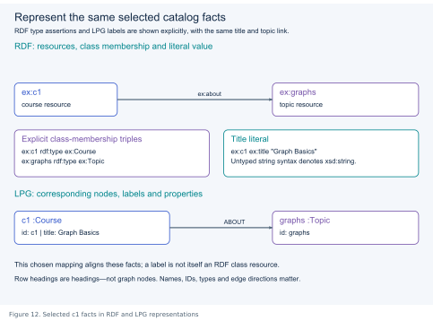

# IV · Property graphs and Cypher

**Version 0.2.0 · Public review draft · Edition DOI: 10.5281/zenodo.24316420**

## 4.1 Labeled property graphs from first principles

> **Learning goals for this part:** Represent the same catalog as labeled nodes and relationships; read Cypher patterns; reproduce equivalent policy results; identify what constraints do not enforce.

We now return to the same learners, courses, and recommendation question, but switch representation. The next chapters rebuild the baseline as a labeled property graph in Neo4j. No domain facts change merely because the syntax changes from RDF/SPARQL to graph patterns/Cypher.

### The model used by Neo4j
A **labeled property graph**, or LPG, has nodes, directed relationships, and properties. A node can have multiple labels. A relationship has a type, a start node, an end node, and can carry properties. A **property** is a named stored value on a node or relationship. Cypher uses patterns that resemble small graph drawings. [[6](xii-references.md#ref6), [20](xii-references.md#ref20)]

The figure shows the same c1-to-Graphs fact in two representations. The upper row uses an RDF predicate; the lower row uses an LPG relationship type. Course and Topic describe entity categories, while the connecting relation says the course is about that topic.



Cypher uses punctuation to draw a pattern. Parentheses enclose a node; square brackets inside an arrow enclose a relationship. A colon introduces a node label or a relationship type. This differs from the colon in RDF's ex:c1, which separates a prefix and local name. Braces hold key–value properties, and quoted text is a string. A name before a colon, as in (m:Person), is a query variable. The arrowhead gives direction. You can revisit the notation card in the reader guide at any point.

**Pattern illustration — one completion relationship.** This small drawing uses a score of 0.9 as an additional illustrative attribute. It is not an executable CREATE statement and it is not the full baseline loader.

```cypher
(:Person {id: 'maya', name: 'Maya'})
  -[:COMPLETED {score: 0.9}]->
(:Course {id: 'c1', title: 'Graph Basics'})
```

This is a pattern illustration, not a standalone write statement. `Person` and `Course` are labels. `COMPLETED` is the relationship type. `id`, `name`, `title`, and `score` are property keys. The arrow supplies direction. A query may match an edge without direction when either orientation is acceptable; the stored relationship still has a direction.

### Practical consequences
The score fits naturally on this particular completion relationship. But if there are repeated attempts, multiple evidence documents, or independent lifecycle rules, an event node can be clearer. Parallel relationships can connect the same two nodes with the same type; they remain distinct relationship instances. RDF duplicate triples do not represent repeated occurrences in the same way.

A label is a useful category, but adding `:Course` does not by itself supply OWL class semantics. Multiple labels do not automatically form a subclass hierarchy. Native properties are convenient values, not independent globally identified resources. Reify a value as a node when it needs its own identity or relationships.

> Property graphs make relationship instances and their attributes convenient. RDF makes globally identified statements and shared vocabularies convenient. Both can represent rich domain models.

## 4.2 Create the same catalog in Cypher

The previous section explained the property-graph picture. Now we create its baseline records. First protect stable IDs with constraints; then create nodes and connect them. The short excerpt below demonstrates the loading pattern, while catalog.cypher supplies the complete dataset.

### Establish identity constraints first
A **uniqueness constraint** prevents duplicate values within its declared scope. It also supports efficient identity lookup through its backing index. A uniqueness constraint alone does not require every matching node to have that property. In Neo4j 5, property existence, property type, and key constraints require Enterprise Edition. The Community lab uses property uniqueness constraints and pipeline validation for the remaining contract rules. Check deployment-specific availability for existence, type, and key constraints. [[7](xii-references.md#ref7)]

**Baseline setup — protect the three kinds of node IDs.** Run these constraint statements in the exercise database before loading records. They prevent duplicate values within each declared label scope.

```cypher
CREATE CONSTRAINT person_id IF NOT EXISTS
FOR (p:Person) REQUIRE p.id IS UNIQUE;
CREATE CONSTRAINT course_id IF NOT EXISTS
FOR (c:Course) REQUIRE c.id IS UNIQUE;
CREATE CONSTRAINT topic_id IF NOT EXISTS
FOR (t:Topic) REQUIRE t.id IS UNIQUE;
```

### Build nodes, then connect them
MATCH finds existing elements that fit its pattern; MERGE matches or creates the stated pattern; SET assigns properties. In the reader guide, Running the examples shows how to open cypher-shell and load catalog.cypher. Run the following loader excerpt only to study its structure; load the complete file for baseline answers.

The following is an excerpt; the companion `catalog.cypher` contains the complete, rerunnable baseline. Run the statements in a dedicated empty exercise database the first time.

**Loader excerpt — create four nodes and their connections.** This intentionally omits Leo, the other courses, and other topics. Use the complete catalog.cypher file when reproducing all baseline counts and answers.

```cypher
MERGE (m:Person {id: 'maya'}) SET m.name = 'Maya';
MERGE (g:Topic {id: 'graphs'}) SET g.name = 'Graphs';
MERGE (c:Course {id: 'c1'})
SET c.title = 'Graph Basics', c.durationMinutes = 60;
MERGE (c:Course {id: 'c2'})
SET c.title = 'Graph Search', c.durationMinutes = 90;

MATCH (m:Person {id: 'maya'}),
      (g:Topic {id: 'graphs'}),
      (c1:Course {id: 'c1'}),
      (c2:Course {id: 'c2'})
MERGE (m)-[:LIKES_TOPIC]->(g)
MERGE (m)-[:COMPLETED]->(c1)
MERGE (c1)-[:ABOUT]->(g)
MERGE (c2)-[:ABOUT]->(g)
MERGE (c2)-[:REQUIRES]->(c1);
```

`MERGE` matches a pattern or creates it when absent. It is not a substitute for uniqueness constraints under concurrent writes. Prefer merging an entity by stable ID and setting mutable descriptive properties separately. A merge containing a mutable title can create unintended extra nodes after a title change. For relationships, bind their endpoint nodes first. [[21](xii-references.md#ref21)]

An operation is **idempotent** if repeating it has the same intended effect as applying it once. This loading pattern is designed for repeatability on the exercise graph; production ingestion also needs concurrency, deletion, and retry policies.

## 4.3 MATCH, WHERE, RETURN, and parameters

Assume the complete Cypher baseline has been loaded. We will repeat two familiar catalog questions: find courses about Graphs, then find courses below a duration limit. Comparing the results with SPARQL helps separate the shared question from language-specific notation.

### Read a pattern as a sentence
Run a complete Cypher statement in the console described in Running the examples. Finish with a semicolon. For the parameterized query, set maxMinutes to 75 first using :param maxMinutes => 75 in cypher-shell.

`MATCH` finds patterns. `WHERE` filters matched candidates. `RETURN` projects values. The variable names `c` and `t` refer to matched graph elements inside the query; they are not persistent identifiers. [[22](xii-references.md#ref22)]

**Baseline query — repeat “which courses are about Graphs?” in Cypher.** `c` names a matched course for this query; `t` names the Graphs topic. The RETURN clause requests the same columns as the earlier SPARQL query.

```cypher
MATCH (c:Course)-[:ABOUT]->(t:Topic {id: 'graphs'})
RETURN c.id AS id, c.title AS title
ORDER BY id;
```

Expected rows: c1 / Graph Basics and c2 / Graph Search. Compare this with the first SPARQL SELECT. The question and answers match even though the models encode categories and attributes differently.

**Baseline parameterized query — apply a duration limit.** Supply maxMinutes = 75 as a query parameter to obtain the expected result discussed below. The parameter is an input value, not a stored property.

```cypher
MATCH (c:Course)
WHERE c.durationMinutes <= $maxMinutes
RETURN c.id AS id, c.title AS title
ORDER BY id;
```

A **parameter**, such as `$maxMinutes`, is a value supplied separately by the client or query tool. With maxMinutes = 75, the baseline returns c1, c3, and c4. The companion duration query uses the same maxMinutes parameter; supply it in your query tool or client (the checker supplies 75). Applications should parameterize user-supplied values. Do not build query text by concatenating untrusted text.

### Index lookup versus graph expansion
An **index** is a lookup structure that can help find starting nodes by values. In the first query, a Topic ID lookup can be followed by expansion to connected courses. An index is not automatically needed for every relationship step, and adding one to every property is not a universal performance strategy. Read the execution plan for the actual query and distribution.

### Scope is part of correctness
A **clause** is a stage in a query. `WITH` carries selected variables and computed values to the next stage. Variables not carried forward leave scope. This makes complex Cypher queries easier to structure, but dropping a variable can change the question or make a later clause invalid.

**Baseline worked query — carry a grouped result forward.** The first clause matches course-topic associations. WITH groups by topic and counts distinct courses; WHERE keeps only counts above one.

```cypher
MATCH (c:Course)-[:ABOUT]->(t:Topic)
WITH t, count(DISTINCT c) AS n
WHERE n > 1
RETURN t.id AS topic, n ORDER BY topic;
```

The baseline returns graphs / 2. After WITH, only t and n remain in scope; c is no longer available. To use c later, the query would need a different stage design. Counting distinct c prevents repeated associations from counting the same course twice in this example.

**Isolated exercise:** begin with the complete baseline in the disposable database. Add a second topic to c2 using the first statement below. Run the second statement and predict the rows for c2; then use the last statement to remove only the added relationship. Other courses remain unchanged.

```cypher
MATCH (c:Course {id: 'c2'}), (t:Topic {id: 'data'})
MERGE (c)-[:ABOUT]->(t);
MATCH (c:Course {id: 'c2'})-[:ABOUT]->(t:Topic)
RETURN c.id AS id, t.id AS topic ORDER BY topic;
MATCH (:Course {id: 'c2'})-[r:ABOUT]->(:Topic {id: 'data'})
DELETE r;
```

Expected rows before cleanup: c2/data and c2/graphs. The result contains two topic associations, not two course entities.

## 4.4 OPTIONAL MATCH, null, and aggregation

The RDF chapter showed that missing summaries and multiple matches affect result rows. We now revisit those same situations in Cypher. Keep the baseline unchanged: Summary nodes are deliberately absent, so the first query demonstrates a missing optional match.

### Missing values need deliberate handling
`OPTIONAL MATCH` preserves the current row and supplies null for unmatched parts. **Null** represents an absent or unknown value in Cypher expressions. A missing property reads as null; setting a stored property to null removes that property. Null comparisons do not behave like ordinary true/false comparisons: use `IS NULL` when testing absence. [[23](xii-references.md#ref23), [24](xii-references.md#ref24)]

**Baseline query — keep courses without summary nodes.** HAS_SUMMARY and Summary are hypothetical optional structures. They are absent from the baseline, so this example tests what happens when the optional pattern finds nothing.

```cypher
MATCH (c:Course)
OPTIONAL MATCH (c)-[:HAS_SUMMARY]->(s:Summary)
RETURN c.id AS id, s.text AS summary
ORDER BY id;
```

The baseline has no Summary nodes, so all four courses appear with null summaries. An optional pattern with several matches produces several rows. Keep a filter that belongs to an optional pattern with that pattern; filtering after a later WITH can remove the preserved null rows and change the result.

### Count entities, not accidental rows
**Baseline query — count distinct courses for each topic.** This repeats the earlier SPARQL aggregation on the LPG representation.

```cypher
MATCH (c:Course)-[:ABOUT]->(t:Topic)
RETURN t.id AS topic, count(DISTINCT c) AS courses
ORDER BY courses DESC, topic;
```

Expected counts: graphs 2, data 1, ethics 1. `count(*)` counts rows, whereas `count(expression)` excludes null values. `DISTINCT` removes repeated values at the selected stage. `collect` builds a list of values; decide whether repeated values are meaningful before using DISTINCT inside it.

### A multiplication trap
If one course has three topics and two evidence documents, matching both relationships can produce six rows for the course. Summing its duration over those rows overcounts it. Aggregate each independent relationship set before combining them, use a subquery, or project distinct entities at the correct scope. This issue occurs in both SPARQL and Cypher because pattern matching combines multiple compatible solutions.

> The storage model does not define your counting unit. Write down whether you are counting courses, topic associations, completion events, or query rows.

## 4.5 Paths, cycles, and bounded expansion

The catalog says c2 requires c1. We now follow that relationship through possible chains and explain why a production query needs an intentional depth policy. The first query reads the baseline; the longer chains and cycles discussed afterward are hypothetical variations.

### Ask a bounded traversal question
A **variable-length path** matches a range of relationship counts. For a Neo4j 5-compatible example, `[:REQUIRES*1..5]` means between one and five REQUIRES relationships. A named path variable can be inspected with path functions. [[22](xii-references.md#ref22)]

**Baseline query — follow c2's prerequisites up to five hops.** The variable p names the whole matched path; r names its reached Course node. We return distinct endpoint IDs, rather than every path.

```cypher
MATCH p = (c:Course {id: 'c2'})-[:REQUIRES*1..5]->(r:Course)
RETURN DISTINCT r.id AS required
ORDER BY required;
```

The baseline result is c1. This query intentionally limits depth; it is not equivalent to an unbounded transitive closure for every graph. If a valid prerequisite chain can be longer than five, it will omit distant requirements. A bound is an operational policy that must be appropriate for the domain.

### Endpoints and routes are different outputs
Returning `r` asks for reached entities. Returning `p` exposes matched paths, potentially many routes to the same endpoint. An **undirected match** ignores stored direction for matching; it is inappropriate if prerequisite direction carries meaning. Neo4j path matching also has relationship-reuse rules; do not assume it returns every possible route, including routes that reuse the same relationship.

### Detect and prevent bad prerequisite structures
A **cycle** returns to an earlier node. A **self-loop** connects a node to itself. A prerequisite cycle can make every course in the cycle depend on the others. Use an offline validation job or a write-time domain check that detects such structures. Requiring unique course IDs does not prevent cycles.

**Shortest path** means minimum path length under a chosen definition. **Weighted shortest path** minimizes accumulated cost rather than the number of hops. These are graph algorithm questions, not the same as proving educational eligibility. A route with few hops can still be unsuitable if prerequisites are missing.

### Operational guardrails
Choose starting nodes through selective keys. Bound depth, result size, and execution time. Test high-degree nodes, not just the tiny catalog. An unbounded traversal can expand rapidly even when the final result is small. Prefer current release documentation when adopting newer path syntax or match modes.

## 4.6 The equivalent recommendation in Cypher

We have the property-graph facts and the Cypher building blocks needed to answer Maya's question. The following query implements the same policy as the earlier SPARQL query on catalogs that satisfy the alignment contract stated in Section 10.3. Its expected answer is still c2, allowing us to compare meaning rather than syntax alone.

### Apply the policy under explicit data rules
The baseline uses LIKES_TOPIC, ABOUT, COMPLETED, and REQUIRES relationships. The query first anchors on Maya as a Person and finds a shared topic. It requires a course id and title for display, then applies the three eligibility conditions: topic fit, no recorded completion, and no unmet recorded prerequisite. The learner and display checks are data-contract checks, not new ranking rules.

**Baseline query — the same eligibility policy, expressed in Cypher.** The outer pattern finds Maya through her Person label and id, then courses sharing a liked topic. The first WHERE line requires non-null course id and title. The two absence conditions remove completed courses and candidates with an unmet recorded prerequisite. Read those checks in code order before comparing the data rules below.

```cypher
MATCH (m:Person {id: 'maya'})-[:LIKES_TOPIC]->(t)
      <-[:ABOUT]-(c:Course)
WHERE c.id IS NOT NULL AND c.title IS NOT NULL
AND NOT EXISTS {
  MATCH (m)-[:COMPLETED]->(c)
}
AND NOT EXISTS {
  MATCH (c)-[:REQUIRES]->(required)
  WHERE NOT EXISTS {
    MATCH (m)-[:COMPLETED]->(required)
  }
}
RETURN DISTINCT c.id AS id, c.title AS title
ORDER BY id;
```

Expected result: c2 / Graph Search. `EXISTS` subqueries ask whether a matching pattern exists, using variables from the surrounding query. Negating the outer prerequisite existence test excludes courses for which at least one unsatisfied requirement can be found.

### Compare meaning before comparing syntax
**When are the two queries equivalent?** Both return c2 on the baseline. Distinguish **single-representation intake rules** from **paired correspondence checks**:
- The RDF shapes require exactly one plain-string id and title for each targeted Course, Course membership for prerequisite targets, and Person membership for targeted learners.
- The baseline LPG loader creates the intended labels and scalar fields. Community uniqueness constraints enforce the declared label-scoped id uniqueness; the remaining intake conditions need separate pipeline checks.
- A paired comparison additionally needs matching course identities and a defined correspondence between the learner IRI and the label-scoped Person.id key. Neither a single-side loader nor SHACL alone checks that cross-model correspondence; Section 10.3's alignment contract and Section 10.4's broader fixture comparison make it explicit.

These baseline rules alone are not a sufficient equivalence contract. Section 10.3 states the scoped alignment condition: identities, memberships and relationships correspond in both directions, with a consistent learner anchor, snapshot, inference and output mapping. It also explains why matching missing fields or missing learner membership can still produce equal answers even when intake rules fail.

The lab's SHACL shapes check field counts, datatypes, prerequisite classes, and learner membership. Cross-record uniqueness and cycles need separate checks. Neo4j Community enforces the declared label-scoped id uniqueness constraints; the intake pipeline must check the other data rules. Person.id also permits an indexed learner lookup; ids do not have to be globally unique across unrelated labels.

Two details align malformed-record behavior. Mandatory SPARQL id/title patterns omit a course missing either value; Cypher's IS NOT NULL guards do the same. Both queries inspect every prerequisite target, including a malformed untyped target, rather than silently ignoring a requirement with the wrong category.

As in Section 3.5, c2 is eligible under the recorded catalog policy; personal suitability has not been assessed. The Cypher result supplies no additional evidence about Maya's current circumstances.

The topic match deliberately has no Topic type/label condition in either query. LearnerShape accepts subclass membership when the required subclass triples are present, but a positive recommendation from the raw queries requires Person membership in their query-visible data. If inferred memberships are intended, make them available consistently before querying. One distinction remains outside the Section 10.3 contract: two RDF titles produce two projected rows, whereas one LPG title property is a single value, possibly a list. Equivalent baseline results are not a guarantee of equivalence for arbitrary malformed data.

Both versions depend on completion-data completeness and a reviewed prerequisite snapshot. Neither proves a person lacks an unrecorded real-world qualification. Both can return duplicate candidate rows before DISTINCT if multiple liked topics match one course. Both need additional policy for retired courses, course editions, evidence freshness, and access restrictions.

### Build an explanation alongside the result
Return a separate explanation structure containing the shared topic, the required course IDs, completion-event IDs, and evidence-document IDs. Do not rely on a generated natural-language explanation to reconstruct the reason later. Log a policy version and data snapshot so the decision can be reproduced.

A useful user explanation would be: “Graph Search matches your interest in Graphs. Its recorded prerequisite is Graph Basics, which you completed.” The explanation must remain accurate when the ranking model changes. Eligibility, ranking, and explanation are separate artifacts even when one query gathers their inputs.

## 4.7 Constraints, transactions, and evolution

The queries explain how to read the application graph. We now shift to keeping it correct while people and importers change it. Use the catalog as the reference point: duplicate IDs, concurrent completion writes, and a later event-model migration are the problems being addressed.

### Enforce what the database can enforce
A **constraint** rejects states or writes that violate a declared rule. An **index** accelerates selected access patterns; a uniqueness constraint can own an index. Neo4j constraint types and availability differ by version and edition. Check support rather than assuming every deployment provides existence, type, and key constraints. [[7](xii-references.md#ref7)]

A uniqueness constraint on Course.id prevents two Course nodes from storing the same ID. It does not guarantee that a course has a title, that a prerequisite is a Course, or that there are no prerequisite cycles. Those rules need supported constraints, domain checks, or pipeline validation. Use a rule inventory that names the enforcement mechanism and owner for each invariant.

### Transactions and concurrency
A **transaction** groups reads and writes with database-defined guarantees. **Atomicity** means its changes are all applied or all rolled back. **Consistency** means committed operations preserve enforced invariants, not that the content is true. **Isolation** describes interaction among concurrent operations. **Durability** concerns committed changes surviving failures under the system's guarantees. Together, atomicity, consistency, isolation, and durability form the transaction-property acronym **ACID**.

A **race condition** occurs when concurrent actions interact in an order-sensitive way. Two importers may both decide a node does not exist. Stable-key uniqueness constraints protect identity better than an application-side “check then create.” Retried operations must be designed not to duplicate completion events. [[21](xii-references.md#ref21)]

### Evolve a model safely
Suppose completions move from direct relationships to event nodes. Introduce event IDs, backfill historical events where evidence permits, verify counts, change readers, then retire obsolete write paths. If historical timestamps are unknown, preserve that uncertainty rather than inventing dates.

A **migration** transforms data or schema between versions. **Backward compatibility** allows existing readers to continue working. A **derived projection** is a convenience representation computed from a more authoritative form. If direct COMPLETED edges are derived from Completion nodes, document rebuild rules and lag.

> “Schema optional” means you can begin with few declarations. It does not remove the need for a domain contract, migration plan, or quality controls.

### Connection to the next part
We can now represent and query the same baseline in both approaches. Next we extend the conceptual model itself, beginning with completion events, before considering mappings and architecture.

### Write a query before reading the solutions
Use the unchanged baseline and the reader-guide setup. These three tasks build on syntax already shown. Write and save your own query first, then compare it with the solutions below. The matching practice_queries file in lab contains the solutions as separate blocks; run one block at a time.
1. Recommend courses for Leo using the full policy. Expected: c3 / Query Patterns.
2. List the courses Maya completed, showing id and title. Expected: c1 / Graph Basics.
3. Count distinct courses per topic but exclude Ethics. Expected: Graphs 2 and Data 1, using the topic terms of this representation.

### Practice solutions — compare after trying
**Solution 1.** Only the learner changes in the eligibility query; Leo likes Data and completed c1.

```cypher
MATCH (m:Person {id: 'leo'})-[:LIKES_TOPIC]->(t)
      <-[:ABOUT]-(c:Course)
WHERE c.id IS NOT NULL AND c.title IS NOT NULL
AND NOT EXISTS {
  MATCH (m)-[:COMPLETED]->(c)
}
AND NOT EXISTS {
  MATCH (c)-[:REQUIRES]->(required)
  WHERE NOT EXISTS {
    MATCH (m)-[:COMPLETED]->(required)
  }
}
RETURN DISTINCT c.id AS id, c.title AS title
ORDER BY id;
```

**Solution 2.** Follow the recorded completion from Maya, then read that course's display fields.

```cypher
MATCH (:Person {id: 'maya'})-[:COMPLETED]->(c:Course)
RETURN c.id AS id, c.title AS title ORDER BY id;
```

**Solution 3.** Filter Ethics before grouping; the remaining groups count distinct course entities.

```cypher
MATCH (c:Course)-[:ABOUT]->(t:Topic)
WHERE t.id <> 'ethics'
RETURN t.id AS topic, count(DISTINCT c) AS courses
ORDER BY courses DESC, topic;
```

### Check your understanding
**Try first:** core questions for this chapter are 1, 4, 6, 10, 13, 15, 18, 20, 23, 25. They cover its main concepts and application decision. Attempt the remaining questions as a second pass. Cover the next answer with a sheet or scroll it out of view while writing your prediction. Compare the explanation only after committing an answer.

This review follows the chapter from the property-graph model through Cypher queries to safe updates. Use the unchanged catalog unless a question explicitly introduces a variation. First predict the result or explain the rule in your own words, then compare your reasoning with the answer. Where the question revisits SPARQL, compare the intended meaning before comparing syntax.

### Review 1 · Read and load the property graph
**Question 1: In the completion pattern, which elements are labels, relationship types, properties, and variables?**

**Answer:** Person and Course are node labels that mark categories. COMPLETED is the relationship type connecting the person to the course. Fields such as id and title are properties, and the illustrative score belongs to the relationship. Names such as m and c are query variables referring to matched elements during that query; they are not durable identifiers. The arrow records the direction of the connection.

**Question 2: Does adding both Course and LearningResource labels define a subclass hierarchy?**

**Answer:** No. It marks that particular node with two labels. It does not declare that every Course is a LearningResource or install OWL reasoning. The domain model must define the intended relationship between categories, and the implementation must provide any required inheritance or inference behavior. Useful category markers and executable formal semantics are different things.

**Question 3: Can two COMPLETED relationships connect Maya to c1? Would they mean the same thing as repeating an RDF triple?**

**Answer:** An LPG can contain distinct relationship instances with the same endpoints and type. They can represent separate occurrences if the model gives them that meaning. Repeating an identical RDF triple in one RDF graph does not create another occurrence because that graph is a set. In either representation, repeated attempts need an explicit identity and history policy; accidental duplicate relationships are not automatically valid new attempts.

**Question 4: Why does the loader MERGE a course by its stable id and SET its title separately?**

**Answer:** The id supplies the intended identity match, while the title is mutable descriptive information. Including a mutable title in the MERGE pattern can cause a rename to stop matching the existing node and lead to an unintended creation attempt or constraint failure. Matching by a stable key and updating the description keeps those responsibilities separate. Uniqueness constraints still matter, especially with concurrent writers.

**Question 5: Is the loader excerpt the complete catalog? What does idempotent mean here?**

**Answer:** No. The excerpt omits some learners, courses, and topics; use catalog.cypher for the full exercise. Idempotent means repeating an operation has the same intended effect as applying it once. The loader is designed to avoid creating another copy of the same baseline nodes and relationships when rerun. That property does not, by itself, settle concurrent ingestion, deletion, or repeated real-world completion events.

### Review 2 · Trace a Cypher query
**Question 6: What do MATCH, WHERE, and RETURN do in the course queries?**

**Answer:** MATCH finds graph patterns, WHERE restricts the matches, and RETURN selects the output values. Matching Course nodes linked by ABOUT to the Graphs topic returns c1 / Graph Basics and c2 / Graph Search in the baseline. The pattern and filter define which rows qualify; projecting id and title decides what the reader sees. Omitting a variable from the output does not remove its role in matching.

**Question 7: With maxMinutes set to 75, which courses pass the duration query? Why supply this limit as a parameter?**

**Answer:** c1, c3, and c4 pass because their durations are 60, 75, and 45 minutes; c2 has duration 90 and does not pass. The comparison includes 75 because it uses “less than or equal to.” A parameter supplies an input separately from the query text. It lets the application vary the value without constructing query syntax by concatenating user input; it is not another stored course property.

**Question 8: If a WITH clause carries only a course id onward, can a later clause still use the earlier course variable?**

**Answer:** Not unless that variable was also carried forward or is introduced again appropriately. WITH defines what remains in scope and can introduce computed values or aliases. Dropping the course variable removes access to that earlier binding in the following ordinary query stages. Plan the variables each stage needs rather than assuming every name remains available throughout a long query.

**Question 9: Does an index replace traversal, and should every property receive an index?**

**Answer:** No. An index can help locate selective starting nodes, such as a topic identified by its id. The engine can then expand along relationships to connected courses. Adding indexes everywhere has storage and update costs and does not guarantee a better plan. Assess the actual query, execution plan, and data distribution; the tiny catalog does not establish production performance.

### Review 3 · Handle nulls, multiplicity, and counts
**Question 10: Why does the optional-summary query return all four courses even though no Summary nodes exist?**

**Answer:** The initial MATCH finds courses. OPTIONAL MATCH preserves those rows when it cannot find a matching summary structure and supplies null for the unmatched parts. Returning s.text therefore yields null alongside each course id. If several summaries match one course, several rows can result instead. Optional matching preserves a missing match; it does not promise exactly one row per course.

**Question 11: How should missing properties be tested, and what does setting a property to null do?**

**Answer:** Use IS NULL to test for an absent value. Ordinary comparisons involving null do not behave like comparisons between known values; for example, an equality comparison to null does not provide the intended absence test. Reading a missing property yields null, and setting a stored property to null removes it. Decide whether absence is acceptable, erroneous, or subject to a default before filtering rows.

**Question 12: Why can a filter after a later WITH remove courses preserved by OPTIONAL MATCH?**

**Answer:** Once the optional pattern has preserved a row with null values, a later filter still decides whether that row survives. A condition that requires a known optional value can exclude the null row. Keep predicates intended to constrain the optional match with that pattern, and distinguish them from conditions intended to reject whole result rows. Filter placement is part of the query's meaning.

**Question 13: What is the difference between count(*), count(expression), and count(DISTINCT c)?**

**Answer:** count(*) counts input rows, including rows with null in individual fields. count(expression) counts non-null evaluations of that expression. count(DISTINCT c) counts distinct non-null course values in its group. Thus four course rows with null optional summaries do not imply four existing summaries. The baseline topic query counts distinct courses and returns graphs 2, data 1, and ethics 1.

**Question 14: In a model extension, one course has three topics and two evidence documents. Why can a combined match produce six rows, and why is DISTINCT on a duration value a poor repair?**

**Answer:** Each topic match can combine with each evidence match, giving three times two compatible combinations. Summing the course duration across those rows repeats its contribution. Deduplicating numeric durations instead of course identities can wrongly merge contributions from different courses with the same duration. Aggregate independent relationship sets separately, use suitable subqueries, or deduplicate the intended entities at the correct stage.

### Review 4 · Follow prerequisites and explain eligibility
**Question 15: What does REQUIRES*1..5 mean, and what does the baseline path query return from c2?**

**Answer:** It matches paths containing between one and five REQUIRES relationships. The baseline returns the distinct endpoint id c1. A valid prerequisite more than five hops away is outside this query's bound, so the query is not a full transitive-closure query for every possible graph. Select a depth limit that fits the domain and make any resulting incompleteness explicit.

**Question 16: How does returning a path differ from returning a distinct reached course? Is ignoring direction safe for prerequisites?**

**Answer:** A path exposes the matched route; a reached course identifies an endpoint. Several routes can reach the same endpoint, so distinct endpoint results can be much smaller than the set of paths. Ignoring direction changes the question by allowing the matcher to follow stored relationships either way. Since “c2 requires c1” is different from “c1 requires c2,” prerequisite direction must be preserved when evaluating those requirements.

**Question 17: Does a shortest prerequisite path establish eligibility or prove the prerequisite graph is valid?**

**Answer:** No. Shortest path concerns minimum path length, or minimum accumulated cost in a weighted variant. Eligibility depends on the stated interest, completion, and prerequisite policy. Graph validity may also require rejecting cycles, self-loops, and wrongly categorized targets. A path can be short while a prerequisite is unmet, and a shortest-path result is not a substitute for those checks.

**Question 18: Read the nested NOT EXISTS recommendation condition in plain language. Why does c2 pass in the baseline?**

**Answer:** Exclude a candidate if there exists a recorded prerequisite for which Maya has no recorded completion. c2 requires c1, and Maya completed c1, so that unmet-prerequisite counterexample is absent. c2 also matches her Graphs interest and has no recorded completion by Maya. As with SPARQL, the decision depends on the selected records and completeness policy; it does not prove an unrecorded real-world qualification is absent.

**Question 19: What happens if c2 gains another matching liked topic or a new unmet prerequisite?**

**Answer:** In separate variations, another liked topic can generate another candidate row for c2; RETURN DISTINCT id and title collapses identical projected results. A new unmet prerequisite changes eligibility instead: c2 fails the absence-of-counterexample condition. These are different effects. Removing repeated output rows does not remove a real unmet requirement, and ranking a course highly does not make it eligible.

### Review 5 · Define the guarantees of a write
**Question 20: Does a unique Course.id guarantee a valid prerequisite graph or require every course to have an id?**

**Answer:** No. The uniqueness constraint prevents duplicate stored id values among Course nodes; by itself, it does not require each Course node to contain an id. It also does not ensure that REQUIRES targets are Courses, prerequisite lists are complete, or cycles are absent. Use supported existence or key constraints where appropriate, plus the necessary domain checks, and record which mechanism enforces each rule. Availability depends on version and edition.

**Question 21: What do ACID guarantees establish, and why can “check then create” still be unsafe?**

**Answer:** Atomicity groups changes so they apply together or roll back; consistency preserves enforced invariants; isolation governs concurrent interactions; durability concerns surviving failures under the database's guarantees. These properties do not establish that a recorded completion is factually true. Two importers can both observe an absent node before either creates it. Stable-key uniqueness constraints and an appropriate transactional write strategy address that race more reliably than a separate application-side existence check.

**Question 22: Why must retry behavior distinguish a repeated request from a genuinely new completion?**

**Answer:** A retry should not silently create a second event for the same intended operation, while a later real attempt may need its own event. Define event identity and idempotency according to that distinction. Reusing only the learner and course as identity can erase meaningful repeated attempts; creating a new identity on every retry can fabricate attempts. A MERGE keyword alone cannot decide the business meaning of those operations.

### Apply the chapter to a defective import
**Question 23: A faulty importer creates a unique Course node c5 and adds “c2 REQUIRES c5” and “c5 REQUIRES c2.” Does a successful commit certify the import as valid?**

**Answer:** No. Unique ids can coexist with this two-course cycle. A commit establishes compliance with the invariants actually enforced, not every rule the application intended. A cycle check should identify the defect, and the publication or write policy should determine how to reject or quarantine it. If those checks must prevent invalid states, their placement and transaction behavior must be designed accordingly. Restore the unchanged baseline after this hypothetical exercise.

**Question 24: What should be preserved when direct COMPLETED relationships are migrated to identified Completion events?**

**Answer:** Preserve the intended learner–course facts, stable event identities, and any supported evidence and timestamps. Backfill only what the historical records justify; keep unknown dates unknown. Verify the conversion, update readers and writers, and retire obsolete write paths deliberately. If direct edges remain as a derived projection, document how they are rebuilt, their update lag, and which event records are authoritative. The next chapter develops that event model in detail.

**Question 25: Does translating the eligibility query into Cypher establish more about Maya's suitability?**

**Answer:** No. With aligned inputs, the query expresses the same recorded catalog policy. A different representation does not create missing contextual evidence. Keep the distinction between an eligible candidate, its ranking and any broader suitability assessment explicit in the interface and explanation.

**Ready to continue:** You should be able to read and load the baseline property graph, predict the main Cypher results, explain null and row multiplicity, and separate uniqueness, domain validity, and transaction guarantees. We now extend the domain model itself rather than merely translating the same facts between query languages.
