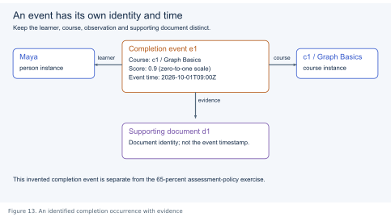
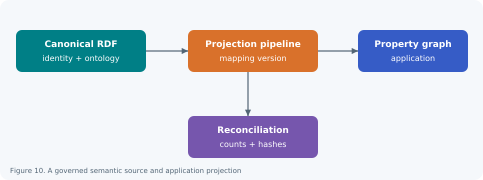

# V · Modeling and interoperability

## 5.1 Model events when relationships have a lifecycle

> **Learning goals for this part:** Choose direct relationships versus identified events; retain evidence and context; describe what a mapping must preserve and who owns each authoritative fact.

Until now, “Maya completed c1” was a single direct link. We now deliberately extend the model because we want a score, a time, and evidence for that particular occurrence. The new event e1 and document d1 are additional records; they were not hidden in the baseline.

### A completion is more than a binary link
For the extension below, assume Maya completed c1 on 1 October 2026 at 09:00 UTC, received a score of 0.9 on a zero-to-one scale, and has supporting document d1. We call that occurrence e1. These are invented additional facts, introduced here for the first time.

A **binary relationship** connects two entities. An **n-ary relationship** involves more participants or roles. A completion can involve a learner, a course edition, an assessment, a timestamp, a score, and evidence. An **event node** gives that occurrence a stable identity. It also makes repeated attempts explicit.

In this extension, e1 identifies Maya's particular completion of c1. The figure separates that occurrence from the learner and course, then links it to evidence d1. Its arrows leave event e1 toward its learner, course, and evidence. This is a different structure from the earlier direct person-to-course completion link. The two code fragments below show RDF and LPG representations of the event structure.



**RDF model extension — describe event e1.** The learner and course IRIs still identify the existing entities. The new event holds the score, event time, and a link to evidence d1.

```turtle
@prefix ex: <https://example.org/> .
@prefix xsd: <http://www.w3.org/2001/XMLSchema#> .

ex:e1 a ex:Completion ;
  ex:learner ex:maya ; ex:course ex:c1 ;
  ex:score "0.9"^^xsd:double ;
  ex:at "2026-10-01T09:00:00Z"^^xsd:dateTime ;
  ex:evidence ex:d1 .
```

**LPG version of the extension.** This excerpt creates e1 and connects it to the existing learner and course. It shows the same event idea, but leaves the evidence link for the surrounding application to add. The two fragments are alternative representations, not two commands for one database.

```cypher
MATCH (m:Person {id: 'maya'}), (c:Course {id: 'c1'})
MERGE (e:Completion {id: 'e1'})
SET e.score = 0.9,
    e.at = datetime('2026-10-01T09:00:00Z')
MERGE (e)-[:LEARNER]->(m)
MERGE (e)-[:COURSE]->(c);
```

The RDF score is explicitly xsd:double to match the intended floating-point representation of the Cypher Float. An untyped Turtle decimal such as 0.9 would instead be xsd:decimal; a mapping must not silently equate the two datatypes.

These are extensions, not replacements automatically applied to the baseline. In production, add event identity constraints and evidence links. If a completion is revoked, retain the event and record its status when audit requirements demand history; derive the current completion link only from qualifying events.

### Choose by the questions
A single relationship property may be enough for one stable interaction. An event node becomes useful for attempts, evidence, approvals, temporal validity, or cross-event references. Both RDF and LPG can use the same event-centered conceptual model. This avoids treating the convenience of edge properties as the only modeling criterion.

## 5.2 Statements about statements and provenance

The event example gave a completion its own identity. We now ask where that record came from and which source supports it. This is a shift from describing a learner's activity to describing the origin and status of the claim about that activity.

### Facts need context
**Assertion provenance** answers who asserted a claim, from which source, when, and through which transformation. **Evidence** supports a claim; **confidence** estimates uncertainty under a declared method. Neither is automatically proof of truth. PROV-O offers standardized concepts for entities, activities, and agents involved in provenance. [[25](xii-references.md#ref25)]

RDF 1.1 **reification** describes a statement using resources and properties such as `rdf:subject`, `rdf:predicate`, and `rdf:object`. Describing a statement does not itself assert that statement. The same described triple may correspond to multiple assertion events. An application must decide whether it is tracking a proposition, an assertion occurrence, or a real-world event. [[16](xii-references.md#ref16)]

**Isolated statement-description fragment.** This describes the proposition Maya completed c1, using a claim identifier. It does not assert the completed triple by itself. The real-world event, the proposition, and a source's act of asserting it can have different identifiers.

```turtle
@prefix ex: <https://example.org/> .
@prefix rdf: <http://www.w3.org/1999/02/22-rdf-syntax-ns#> .
ex:claim1 a rdf:Statement ;
  rdf:subject ex:maya ;
  rdf:predicate ex:completed ;
  rdf:object ex:c1 .
```

For example, a document can claim the completion and another can dispute it without creating two real-world completion events. Record source support and review status on the appropriate assertion records; the fragment above only teaches how the proposition is described.

### Three modeling choices
| Pattern | Useful when | Watch for |
|---|---|---|
| Named graph | An assertion set shares source or publication context | Define what its name means and how graph access works |
| Claim / event node | Each occurrence needs identity and evidence | More nodes and joins, but explicit lifecycle |
| Statement annotation support | The chosen implementation supports a suitable statement model | Check exact syntax, semantics, and export behavior |

**RDF-star** historically refers to work on statements about statements. RDF 1.2 introduces triple terms and related reification facilities, but deployment support and syntax must be checked against a specific specification and engine version. This tutorial uses RDF 1.1-compatible event and claim modeling in its executable baseline. Do not copy older annotation syntax and assume it has identical RDF 1.2 behavior. [[8](xii-references.md#ref8)]

### A practical evidence record
Returning to the new e1 record, consider the claim “Maya completed c1.” To make its origin traceable, store a claim ID, source document ID, page or span locator, extraction method, asserted time, reviewer status, and the referenced entity IDs. Distinguish source publication time, extraction time, and the time the event happened. If the document is replaced, preserve enough version information to reproduce the original decision.

An LPG relationship can carry a source ID and timestamp directly. If several sources support the same relationship, represent support separately instead of overwriting one source property with the latest observation.

## 5.3 Ontology design as an iterative discipline

Earlier sections introduced ontology constructs one at a time. We now put them into a design workflow: start with the catalog's questions, settle the meaning of Course and Completion, and choose only the rules that serve those questions. This section describes a process rather than new baseline data.

### A minimal engineering cycle
Begin with users and competency questions. Write a scope statement: this ontology covers course offerings, topics, prerequisites, completions, and evidence; it does not describe every aspect of education. Create a term list with definitions and examples. Resolve ambiguous terms before converting them into classes.

Choose whether “Course” means an abstract subject, a published edition, or a scheduled delivery. Mixing those levels is a common cause of contradictory completion records. Model roles explicitly: “instructor” may be a role a Person holds in one delivery, not a permanently disjoint kind of person.

### From definitions to rules
Write natural-language definitions first. Then decide which belong in an ontology, which in SHACL, and which in application policy. “Every completion has one recorded learner” is a useful input constraint. “A completion is an educational event” is a classification commitment. “A learner can access the next course only after a passing score” is an operational policy requiring context.

Use a **namespace**, a controlled identifier space, to publish terms. Write human-readable labels and comments. A **deprecation** marks a term as discouraged without deleting its historical meaning. A **version IRI** can identify a specific ontology release. An **import** brings another ontology into scope; review imported commitments because they can change entailments. [[14](xii-references.md#ref14)]

### Review and regression
Maintain a small set of positive examples, negative input cases, and expected query results. A **regression check** catches behavior that changed after a modification. If a subclass relationship changes, rerun classifications, shapes, and application queries that depend on it. Do not review ontology changes only as text diffs.

Use lightweight vocabularies where sufficient. SKOS can organize topics; OWL class axioms can capture formal category constraints; SHACL can validate catalog records. These artifacts can coexist. Reuse a vocabulary because its meaning fits, not merely because its terms resemble yours. [[13](xii-references.md#ref13)]

> A useful ontology is one whose definitions, consequences, and maintenance responsibilities are understood by the people who depend on it.

## 5.4 Map RDF and LPG without losing meaning

We have represented the catalog twice. Now suppose we must exchange data between those representations. The question is no longer whether both can describe c1; it is whether identifiers, languages, repeated events, and source contexts survive a conversion.

### Start with a declared mapping contract
A **mapping** states how one representation corresponds to another. A **round trip** exports data and imports it back. A mapping is **lossless** for a specified scope when it preserves all distinctions required by that scope. There is no single universally lossless “RDF to property graph” shortcut for every possible graph and application.

| RDF construct | Possible LPG representation | Required decision |
|---|---|---|
| Resource IRI | Node with unique iri property | Preserve the full IRI and identity scope |
| rdf:type | Node label or INSTANCE_OF edge | Retain class IRI; decide multiple-class semantics |
| Resource-valued predicate | Typed relationship | Avoid namespace collisions in relationship names |
| Literal-valued predicate | Property or value node | Preserve datatype, language, and multiplicity |
| Named graph membership | Context node or assertion metadata | Keep multiple assertion contexts distinct |
| Blank node | Scoped generated node key | Do not treat a local label as global identity |

### A subtle round-trip failure
Suppose c1 has both `"Graph Basics"@en` and a translated title. Mapping both to one string property discards a language distinction or overwrites a value. A list of strings may retain text while losing language tags. A value-node representation can preserve both. Similarly, mapping two predicates with different namespaces to the same relationship type `ABOUT` loses their distinct meanings.

### Relationship identity is asymmetric
An LPG can contain two COMPLETED relationship instances with identical endpoints, type, and properties. Mapping both to one RDF triple collapses them because the RDF graph is a set. Map repeated occurrences to identified events or claims. Conversely, an RDF graph can make statements about a property IRI; a bare LPG relationship-type name is not automatically an independently addressable domain node.

### Verify the contract
Test term counts by category, datatype and language retention, graph-context retention, parallel edges, blank-node scope, and reconstructed query answers. Comparing raw node and triple counts alone is not sufficient because valid transformations can change those counts while preserving meaning.

## 5.5 Integration architecture: one graph or two?

A mapping describes correspondence between representations. An architecture decides which representation owns the facts and how changes move between systems. We now use the catalog to compare single-store and dual-store designs, with particular attention to stale completions and conflicting edits.

### Three viable patterns
A **canonical model** is the authoritative representation for a defined concern. A **projection** is a derived view optimized for a workload. A **hybrid architecture** uses more than one model or storage engine with explicit responsibilities.

The figure illustrates the semantic-primary option: canonical RDF feeds a derived application graph through a versioned mapping. Reconciliation checks whether the projection still agrees with its source. This is one choice, not a requirement to maintain two stores.



- **Semantic primary:** maintain canonical identities, vocabulary, and assertions as RDF; serve SPARQL directly or publish derived application views.
- **Application primary:** maintain operational entities and events in an LPG; export RDF where interoperability and vocabulary alignment are required.
- **Dual model:** maintain governed semantic data and an application graph, with a controlled transformation pipeline and reconciliation process.

### Avoid an accidental dual master
If both stores independently edit the same fact, conflict resolution becomes part of the product. Assign ownership at field or entity level. For example, the catalog controls prerequisites while the completion service controls completion events. An **outbox** records change events alongside authoritative writes for later delivery. For example, publishing catalog change 42 also records a message to update the application graph. A **watermark** records how far a consumer has processed the stream: watermark 41 means change 42 has not yet been acknowledged there. These are delivery concepts, not additional RDF syntax.

A **change data capture** pipeline transfers changes from a source. **Eventual consistency** permits temporary differences while updates propagate. The application must know whether a stale completion could lead to an incorrect recommendation. Use a freshness bound or a direct authoritative check for sensitive decisions.

### Reconcile more than counts
Compare stable IDs, key relationship sets, deleted records, mapping versions, and expected query answers. Make projections rebuildable. Keep a last-successful watermark and a recovery procedure. Price the second store's operation, on-call responsibility, data transfer, and migration burden before selecting a hybrid design.

R2RML standardizes mappings from relational data to RDF and can support materialized or virtual views. A **virtual graph** exposes mapped data without necessarily storing all RDF statements separately. Virtualization can reduce duplication but shifts query planning and availability dependencies toward source systems. [[26](xii-references.md#ref26)]

### Connection to the next part
The modeling options are now explicit. The next part uses those options to compare strengths and make a requirements-based choice, instead of judging either technology by its terminology alone.

### Check your understanding
**Try first:** core questions for this chapter are 1, 2, 6, 8, 11, 15, 19, 20, 22. They cover its main concepts and application decision. Attempt the remaining questions as a second pass. Cover the next answer with a sheet or scroll it out of view while writing your prediction. Compare the explanation only after committing an answer.

This chapter extended the baseline: e1 is an identified completion event and d1 is its supporting document. They are not hidden records in the original lab. The questions below move from identifying an occurrence to preserving its evidence, mapping its representation, and deciding which system owns it. Explain what must survive each change before choosing a storage pattern.

### Review 1 · Give occurrences their own identity
**Question 1: What is lost if two completion occurrences become one RDF completion triple?**

**Answer:** The distinction between the occurrences is lost. “Maya completed c1” records a connection but does not distinguish two attempts with different times, scores, or evidence. An RDF graph contains only one copy of an identical triple. Preserve separate event identities and attach the relevant learner, course, time, score, and evidence to each occurrence. The same principle applies when exporting distinct LPG relationships that happen to have identical endpoints and properties.

**Question 2: When is a relationship property sufficient, and when is an event node preferable?**

**Answer:** A property can be sufficient when one stable relationship needs a simple attribute and no independent lifecycle. An event node becomes useful when an occurrence must be identified, referenced by other records, supported by several documents, approved, revoked, or distinguished from repeated attempts. Choose according to the questions and history requirements. Neither RDF nor LPG forces every interaction into one pattern; both can use the event-centered conceptual model.

**Question 3: Does the event e1 replace Maya or c1, and is the event model exclusive to RDF?**

**Answer:** No. e1 identifies the completion occurrence; Maya still identifies the learner and c1 still identifies the course. Links from the event specify their roles in that occurrence. Both RDF and LPG can represent those participants and roles. Changing a binary connection into an event structure changes how the occurrence is described, not the identity of its participants.

**Question 4: Does the LPG event fragment preserve every detail of the RDF event fragment automatically?**

**Answer:** No. The RDF fragment includes an evidence link to d1. The LPG excerpt creates the event and its learner and course links, but explicitly leaves the evidence link for the application to add. Both illustrate the event approach, yet the shown fragments are not complete, lossless translations of each other. Compare the actual fields and connections, rather than assuming matching event names guarantee equivalent content.

**Question 5: If a completion is revoked, should its event always be deleted?**

**Answer:** That depends on the retention and audit policy. Where history must remain explainable, retain the event and record its status and relevant change context. A derived current-completion link should then depend only on events that still qualify under the policy. Keeping the history does not mean treating a revoked event as current evidence of eligibility. Separate the historical occurrence from the application's present decision.

### Review 2 · Separate activity, assertion, and evidence
**Question 6: How does a completion event differ from an assertion that the completion happened?**

**Answer:** The completion event describes Maya's activity. An assertion occurrence describes a source or agent making a claim about that activity. Two documents can assert the same completion without describing two different completions. Conversely, two real attempts can have similar descriptions while remaining distinct events. Decide whether an identifier names the activity, the proposition being expressed, or a particular assertion before merging records.

**Question 7: Does describing a statement with RDF 1.1 reification assert that statement?**

**Answer:** No. Reification can describe a statement's subject, predicate, and object without asserting the described triple. An application might use that structure to record a disputed or rejected claim. The meaning of any additional assertion record must be explicit. Do not treat the presence of statement metadata as automatic evidence that the application accepts the statement as a fact.

**Question 8: What is the difference between provenance, evidence, and confidence?**

**Answer:** Provenance records origin and transformation history, such as who asserted a claim and how it entered the catalog. Evidence is the material offered in support, such as a particular document passage. Confidence estimates uncertainty under a stated method. None alone proves the claim true: a well-documented extraction can still be wrong, and a high score without a defined interpretation is not a substitute for evidence or review.

**Question 9: Why record event time, source publication time, and extraction time separately?**

**Answer:** They describe different moments. Maya may complete a course before a certificate is published, and the application may extract the claim later still. Substituting extraction time for completion time changes the domain fact. Preserve the source version and page or span locator as well, so a later reviewer can reproduce what evidence was available when the decision was made. Unknown times should remain unknown.

**Question 10: If two sources support one completion claim, why is overwriting a single source property inadequate?**

**Answer:** Overwriting retains only the latest source and loses independent support and its history. It also makes it difficult to withdraw one source while retaining another valid justification. Represent the support records separately when that distinction matters, with their own source references and context. A named graph can group assertions sharing context, but its name alone does not authenticate the sources or prove their claims.

### Review 3 · Engineer the domain model deliberately
**Question 11: Why define what “Course” means before creating more classes and properties?**

**Answer:** An abstract course, a published edition, and a scheduled delivery are different possible identity boundaries. Mixing them can make a completion appear to satisfy a prerequisite for the wrong edition or delivery. Write the intended meaning and competency questions first, then choose identifiers and relations that support it. More formal syntax cannot resolve an undefined distinction on its own.

**Question 12: Should “a completion is an educational event,” “one recorded learner is required,” and “a passing score permits access” be implemented in the same way?**

**Answer:** Not necessarily. The first is a classification commitment suitable for the conceptual model and, if needed, ontology axioms. The second is an input acceptance condition suitable for validation. The third is an operational policy that needs context, including what counts as passing and which course access is being decided. They can share vocabulary while requiring different execution and enforcement mechanisms.

**Question 13: How do a namespace, a version IRI, and deprecation support maintenance?**

**Answer:** A namespace provides a controlled identifier space for terms. A version IRI can identify a specific ontology release, allowing dependent systems to record which definitions they used. Deprecation marks a term as discouraged without erasing its historical meaning. These mechanisms help readers and applications interpret older records, but they still need a documented migration and compatibility policy.

**Question 14: Why review ontology imports and rerun regression checks after a hierarchy change?**

**Answer:** Imported axioms and changed subclass relationships can alter logical consequences, even if the original instance data is unchanged. Those consequences may affect classifications, validation targets, and query answers. Check representative positive cases, negative input cases, and expected competency results rather than reviewing only the edited text. Reuse an external vocabulary when its meaning fits the domain, not just because its labels look familiar.

### Review 4 · Test what a mapping preserves
**Question 15: What does “lossless mapping” mean, and must a lossless round trip preserve raw node and triple counts?**

**Answer:** Losslessness is relative to a declared scope: the mapping must preserve the distinctions and behavior required by that contract. It need not preserve raw counts because one entity or relationship can require several statements or nodes in another representation. Compare stable identities, values, context, occurrence distinctions, and reconstructed query answers. Equal counts alone cannot demonstrate semantic preservation.

**Question 16: What can be lost when English and translated titles become one string property or an untagged list of strings?**

**Answer:** One string can overwrite another title or erase the distinction between them. A list can preserve both texts while losing their language tags, and may also lose relevant datatype distinctions. The mapping contract must specify how each value's language, datatype, and multiplicity survive. Separate value records are one possible representation when ordinary properties cannot retain the required distinctions.

**Question 17: Why is mapping two different predicate IRIs to the same relationship type ABOUT risky?**

**Answer:** Their identical local names do not establish identical meanings. If their namespaces distinguish different predicates, collapsing both into ABOUT removes the information needed to reconstruct which relation was asserted. Preserve full predicate identity through an explicit mapping convention or suitable metadata. Similar caution applies to class labels: a convenient label should not silently replace the original class IRI and its meaning.

**Question 18: Which less visible distinctions should a round-trip fixture include?**

**Answer:** Include parallel relationship instances, multilingual and typed values, multiple assertion contexts, and blank nodes from separate source scopes. Local blank-node labels must not become global keys that accidentally merge unrelated resources. Check statements about property IRIs as well: an RDF property can itself be described, while a bare LPG relationship-type name is not automatically an independently addressable domain entity. Test the distinctions the application actually needs.

### Review 5 · Assign ownership and manage freshness
**Question 19: Does interoperability require maintaining both an RDF database and an LPG database?**

**Answer:** No. A semantic-primary design can serve RDF directly or publish derived views. An application-primary design can keep operational data in an LPG and export RDF where required. A dual-model design is another option, with a controlled transformation pipeline. Select the arrangement that meets the workloads and ownership requirements; operating a second store adds synchronization, recovery, and maintenance responsibilities.

**Question 20: What is an accidental dual master, and how should the catalog avoid it?**

**Answer:** It arises when both stores independently edit the same facts without clear authority or conflict rules. Assign ownership at a useful scope, such as the catalog owning prerequisites and a completion service owning completion events. Make downstream projections derive those facts through a defined mapping. Calling one store “canonical” is insufficient unless writers, conflict handling, and deletion rules honor that ownership.

**Question 21: What do an outbox and a watermark contribute, and do they remove all synchronization risk?**

**Answer:** An outbox records change events alongside authoritative writes so they can be delivered later. A watermark tracks how far a consumer has processed the stream. They support delivery and recovery design but do not automatically guarantee fresh projections, correct transformations, or duplicate-free handling. Consumers still need defined retry behavior, error recovery, and reconciliation against the authoritative data.

**Question 22: Why can a stale projection produce an incorrect recommendation, and what should reconciliation compare?**

**Answer:** It can omit a recent completion, retain a revoked completion, or miss a new prerequisite. Define an acceptable freshness bound or consult the authoritative source before decisions that require fresher evidence. Reconciliation should compare stable IDs, important relationship sets, deleted records, mapping versions, and expected answers, rather than only counts. A rebuild procedure and last-successful watermark help recover a projection that has drifted.

**Question 23: Does a virtual RDF graph eliminate dependence on the source system?**

**Answer:** No. It exposes mapped data without necessarily storing a separate copy of every RDF statement, which can reduce duplication. Query planning, performance, and availability can then depend more directly on the underlying sources and mapping layer. R2RML standardizes relational-to-RDF mappings; it is not a universal RDF-to-LPG conversion standard. Choose virtualization according to those operational dependencies and the required semantics.

### Apply the chapter to a proposed shortcut
**Question 24: An exporter turns two attempts into one completed triple, keeps only the latest source, and replaces unknown historical dates with today's date. Is a matching course count enough to accept the export?**

**Answer:** No. It has collapsed occurrences, discarded independent source history, and invented event times. Matching counts cannot repair those losses. Preserve separate event identities and support records, represent unknown dates honestly, and state which current-completion links are derived under the policy. Test the reconstructed attempt history, evidence references, and relevant query answers before accepting the mapping. A summary view can intentionally omit detail only when its limited purpose is explicit and the authoritative detail remains available where required.

**Ready to continue:** You should be able to distinguish an event from a claim about it, choose where evidence belongs, define a mapping's preservation contract, and assign authority and freshness responsibilities. The next part uses these modeling choices to compare complete architectures against actual requirements.

