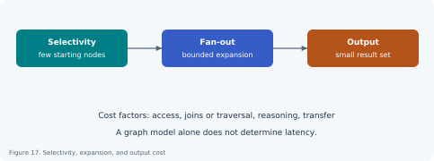

# VII · Performance and operations

**Version 0.2.0 · Public review draft · Edition DOI: 10.5281/zenodo.24316420**

## 7.1 Performance: measure the workload, not the slogan

> **Learning goals for this part:** Design a fair workload experiment; separate replication, recovery, and scale; preserve meaning, lineage, and permissions through updates and derived views.

An architecture choice needs operational evidence, not just an attractive model. We now return to the recommendation query and ask what makes it expensive: the starting set, the number of relationships expanded, and the amount of output or reasoning required.

### Cost follows the shape of the question
**Selectivity** is how strongly a predicate narrows candidates. **Cardinality** is the number of rows or matches at a stage. **Fan-out** is the number of outgoing or incoming connections considered during expansion. **Skew** means some entities have far more connections than typical ones. These often matter more than the visual simplicity of a query.

The figure follows three contributors to query cost: find starting entities, expand relationships, and produce results. For Maya's question, that means finding her record, examining relevant courses and prerequisites, and returning a small set of eligible courses.

### RDF execution considerations
A store may use multiple triple or quad index orders, statistics, join planning, and specialized path processing. Selective patterns reduce intermediate results. Named-graph filters, optional patterns, broad joins, reasoning closure, and remote SERVICE calls can affect cost. A formal ontology is not itself a performance problem; the executed reasoning tasks and data distribution determine the work.

### LPG execution considerations
A selective indexed anchor can reduce the starting set before traversal. Dense hubs, repeated expansions, wide results, and Cartesian combinations can dominate cost. A **Cartesian product** combines every row of one independent set with every row of another. Sometimes intended, it is often a sign that a connecting condition is missing.

Use `EXPLAIN` to inspect the planned query and `PROFILE` to execute with runtime information in Neo4j. PROFILE runs the query, including writes if the query contains them; use read-only examples or a safe exercise database. Compare estimated and actual row counts and inspect index access versus scans. [[27](xii-references.md#ref27)]

### What cannot be concluded
No benchmark is provided here. “RDF uses joins” does not prove it is slower. “A graph follows pointers” does not prove a traversal is cheap. Both implementations and workload shape matter. Compare actual engines, configurations, query semantics, datasets, and resource budgets.

## 7.2 Design a fair benchmark

The previous section identified possible sources of cost. We now design an experiment to measure them fairly. The catalog remains our conceptual example, but a meaningful benchmark must enlarge it and include realistic distributions, concurrent activity, and independently checked answers.

### Build a workload with expected answers
A **benchmark** is a repeatable measurement under declared conditions. Include lookup, bounded prerequisite traversal, recommendation filtering, event ingestion, evidence retrieval, and export. Verify answers first: a fast query that omits an eligibility condition is not a successful optimization.

Before reading the checklist, separate three measurements. **Latency** is time per request; **throughput** is completed work per unit time; a **latency percentile** summarizes a distribution of request times. We interpret p50 and p95 below. Hardware measurements include **CPU** use (central processing unit activity), memory use, and **I/O** (input/output work such as storage reads and writes).

| Dimension | What to record |
|---|---|
| Dataset | Entity counts, edge counts, degree distribution, literal sizes, topic overlap, provenance volume |
| Semantics | Explicit versus inferred facts, duplicate handling, named graphs, path bounds, completeness policy |
| Environment | Engine version, edition, configuration, CPU, memory, storage, network |
| Load | Query mix, concurrent clients, update frequency, read/write ratio |
| Metrics | Latency percentiles, throughput, errors, CPU, memory, I/O, ingest lag |
| Reproducibility | Generator seed, scripts, query text, snapshots, warm-up, repetitions |

### Interpret the measurements
For the latency measurements just introduced, **p50** is the median; **p95** is a value at or below which 95% of observations fall. Tail latency matters when users wait for the slow requests. Report timeouts and failures separately rather than excluding them from the measurements.

A **cold-cache** run starts without relevant data already cached; a **warm-cache** run benefits from prior access. Distinguish both. Repeatedly executing one tiny query on a fully cached toy graph tells little about a mixed production workload.

### Optimize transparently
Record each added index, projection, materialized inference, and precomputed feature. Include the cost to maintain them during updates. Run correctness checks after every optimization. Increase graph size and concurrency independently to identify bottlenecks. Include high-degree topics and long prerequisite chains rather than only uniform synthetic data.

A useful experiment can reject both candidates: if the question is mostly large text aggregation over documents, a graph may be an auxiliary structure rather than the primary processing engine. Let the workload determine the architecture.

## 7.3 Scale, transactions, backup, and recovery

A benchmark measures normal execution. Operating the catalog also means handling growth, concurrent changes, and failure. This section separates those concerns so that “a graph cluster” is not mistaken for an answer to every availability or recovery problem.

### Distinguish scale strategies
**Vertical scaling** adds resources to one machine. **Horizontal scaling** adds machines. **Replication** maintains copies for availability or read service. **Partitioning**, or sharding, distributes data across partitions. These are different mechanisms. A cluster does not automatically make every query parallel or remove cross-partition costs.

Relationship-heavy queries can cross partition boundaries. A design partitioned by learner may still traverse to shared courses and popular topics. RDF federation has similar remote-dependency issues in a different form. Assess locality and high-degree shared entities before selecting a distribution strategy.

### Transactions are an engine concern
RDF and LPG are data models, not isolation levels. Check the actual database documentation for atomicity, locks, isolation, retries, deadlock behavior, and read consistency. Neo4j transactions provide database-defined guarantees; application code must still handle retryable failures and preserve idempotency. [[28](xii-references.md#ref28)]

A **deadlock** is a cycle of transactions waiting on resources held by one another. A **retry** reattempts a failed operation. Stable event identifiers and deterministic writes reduce duplication risk. Do not place external side effects, such as sending a notification, inside code that may be retried without a separate delivery design.

### Backup is only useful if restoration works
A **backup** is a recoverable copy. A **restore test** demonstrates that the copy can recreate a usable system. **Recovery point objective**, RPO, is the tolerated amount of lost data measured in time. **Recovery time objective**, RTO, is the tolerated time to restore service. Replication alone is not a backup against accidental deletion propagated to replicas.

Test restoration of data, indexes, constraints, ontology versions, shapes, mappings, permissions, and evidence references. Then execute competency queries. If a projection is rebuildable, measure its rebuild time against the service requirement. Keep a procedure for partially failed imports and for rolling back a bad ontology or mapping release.

> Plan for the graph, its configuration, and its provenance to recover together. Restoring only nodes and edges can leave the application unable to reproduce prior decisions.

## 7.4 Governance, lineage, and schema ownership

Even a fast and recoverable graph can produce confusing answers if nobody owns the meaning of its terms or the history of its changes. We now identify the people and versioned artifacts needed to explain a catalog decision months after it was made.

### Assign responsibilities to artifacts
**Data governance** defines who may create, interpret, change, publish, and retire data. A **steward** maintains meaning and quality for a domain. A **data owner** is accountable for the authoritative data. **Lineage** traces how an output was produced from inputs and transformations. These responsibilities apply to both graph approaches.

| Artifact | Typical owner | Review evidence |
|---|---|---|
| Entity identity policy | Domain steward | Merge rules, ambiguous examples, reversals |
| Ontology / vocabulary | Semantic model maintainer | Definitions, competency questions, entailment changes |
| SHACL / validation rules | Quality owner | Positive and negative examples, severity policy |
| Application graph schema | Application team | Queries, constraints, migration plan |
| Mapping / projection | Integration owner | Round-trip tests, deletions, reconciliation |
| Evidence / source catalog | Content owner | Source versions, retention, rights, review status |

### Version the dependencies of a decision
A recommendation record should identify the learner and course, input snapshot or watermark, policy version, model version if ranking is learned, ontology and shapes versions where relevant, and evidence used. Without this context, a later query against changed data may give a different answer with no explanation.

**Data quality dimensions** include accuracy, completeness, consistency, timeliness, and uniqueness. They are distinct: a complete file can contain false information, and a unique record can refer to the wrong real-world course. Define metrics that reflect the decision risk rather than reporting only ingestion success.

DCAT, the Data Catalog Vocabulary, can describe datasets and their distributions. A **distribution** is an accessible representation of a dataset, such as a downloadable RDF file or a response supplied through an **application programming interface (API)**, a defined way for software to request and exchange data. Catalog metadata helps discovery and governance but does not certify the truth of every statement. [[29](xii-references.md#ref29)]

Section 5.3 works through a source rename, a changed completion definition and a dated passing policy. Retain mapping versions as well as ontology and shape versions when reconstructing an earlier decision; a stable ontology alone does not keep the output stable.

### Deprecate with a migration path
When replacing a term or changing prerequisite semantics, publish a replacement, explain changed meaning, set a transition window, and identify dependent queries. Keep historical versions available when needed to reproduce prior outcomes.

## 7.5 Security and privacy across graph boundaries

The catalog contains learner-specific completions, so correct answers also need correct permissions. We now follow a learner fact through queries, exports, derived views, and generated explanations to show where access or deletion rules must continue to apply.

### Graph structure can reveal sensitive information
Access to a node can expose information through its neighbors. A course-completion path may reveal a learner's identity, training status, or protected workplace role even if a direct profile field is hidden. **Authorization** decides what a user may access. **Authentication** establishes who the user is. Neither follows automatically from a named graph or a node label.

A **tenant** is an isolated customer or organizational scope. A **least-privilege** policy grants only the permissions required for an action. Apply tenant and permission checks at all entry points, including search, graph expansion, exports, caches, analytics, and generated answers. A filtered user interface is not a substitute for enforced access controls.

### Treat query generation as an untrusted input path
Parameterize values. Limit accepted query structures when using generated queries. Use read-only credentials for question answering. Bound execution time and result size. Restrict remote SPARQL SERVICE endpoints. Avoid exposing unrestricted database procedures through a natural-language interface.

**Query injection** manipulates query syntax through untrusted input. **Prompt injection** supplies text intended to redirect a language model's behavior. A source document used as evidence should be treated as content, even if it contains imperative sentences. It must not be allowed to change access policy, select unrestricted tools, or override the application's instructions.

### Deletion and derived data
A privacy deletion may need to propagate to graph nodes, events, claims, document chunks, embeddings, search indexes, caches, and analytics projections. **Retention** defines how long information is kept. **Pseudonymization** replaces direct identifiers while preserving a linkable identity under controlled conditions; it does not necessarily make a graph anonymous.

Audit access and changes with enough information to investigate incidents, while protecting logs themselves. Check licenses and permissions for source documents before distributing a graph or a tutorial dataset derived from them. The example data in this book is synthetic and contains no real learner records.

### Connection to the next part
The catalog now has an operational context as well as a model. Next we add natural-language answering and examine how graph RAG must preserve those same identity, policy, evidence, and permission boundaries.

### Check your understanding
**Try first:** core questions for this chapter are 1, 5, 6, 9, 12, 13, 15, 17, 20. They cover its main concepts and application decision. Attempt the remaining questions as a second pass. Cover the next answer with a sheet or scroll it out of view while writing your prediction. Compare the explanation only after committing an answer.

This chapter tested what a graph system needs beyond a correct small example: realistic measurements, recovery, accountable ownership, and enforced permissions. The questions follow those responsibilities in order. Treat numerical service targets as requirements to define and measure, not results already established by this tutorial. Explain which evidence would support each operational claim.

### Review 1 · Explain the work a query performs
**Question 1: Why can a query with a short graph pattern still be expensive?**

**Answer:** Its starting set can be large, a popular topic can have high fan-out, and compatible matches can multiply into many intermediate rows. A small final result does not imply that little work was performed. Selectivity, cardinality, skew, and output width matter alongside query syntax. Inspect the actual workload and plan rather than estimating cost from how compact the query looks.

**Question 2: How does a selective indexed anchor help, and what can remain expensive afterward?**

**Answer:** It can narrow the starting set efficiently, for example by finding one learner through a stable id. Subsequent expansions can still encounter dense hubs, long prerequisite chains, optional matches, or large evidence sets. An index addresses selected lookups; it does not guarantee that all later graph work is cheap. Test both the entry point and the downstream operations.

**Question 3: What is a Cartesian product, and why might DISTINCT conceal rather than solve its cause?**

**Answer:** It combines every row from one independent set with every row from another. If patterns intended to refer to the same course use unrelated variables, they can create many unintended combinations. DISTINCT can remove identical projected outputs while leaving the unnecessary work and incorrect associations in place. Check the joining conditions and intended counting unit before treating repeated rows as a presentation problem.

**Question 4: How do EXPLAIN and PROFILE differ, and why should PROFILE be used carefully?**

**Answer:** EXPLAIN shows a planned execution without running the query. PROFILE executes it and supplies runtime information, such as observed row counts. A profiled write query still writes; profiling is not a read-only simulation. Use appropriate exercise data and permissions, and compare estimated and actual behavior. A plan for one data distribution is not proof of performance under every load.

### Review 2 · Make benchmark claims reproducible
**Question 5: What must be equal or explicitly accounted for when comparing an RDF stack with an LPG stack?**

**Answer:** Match the conceptual facts, required answers, eligibility policy, and declared workload. Record resource budgets, engine versions, reasoning, path bounds, duplicate handling, and precomputed views. Equivalent results can involve different representations and plans, so identical syntax or raw storage counts are not required. A candidate that omits a condition or serves older data is not answering the same question merely because it responds faster.

**Question 6: How do latency, throughput, p50, and p95 describe different aspects of service?**

**Answer:** Latency measures time per request; throughput measures completed work per unit time. p50 is the median observed latency, while p95 describes a tail threshold at or below which 95% of observations fall. A system can have an acceptable median and slow tail requests. Report the load, measurement method, errors, and timeouts alongside percentiles rather than quietly excluding failed requests.

**Question 7: Why separate cold-cache and warm-cache runs and include skewed data?**

**Answer:** Cached data can make repeated requests much cheaper than first access. Popular topics and high-degree nodes can create costs absent from a uniform toy graph. Distinguish cache conditions and include representative degree distributions, topic overlap, and long chains. Otherwise, the experiment may measure an unusually favorable case rather than the conditions users will encounter.

**Question 8: Why rerun correctness checks and include maintenance cost after an optimization?**

**Answer:** A projection, materialized inference, or precomputed feature can improve reads while changing freshness, update cost, or even answers if maintained incorrectly. Verify expected outputs after the change and measure the work needed to keep the optimization current. A faster query is not a successful improvement if it silently loses prerequisites or cannot meet the required update rate.

### Review 3 · Separate scale, availability, and recovery
**Question 9: How do vertical scaling, horizontal scaling, replication, and partitioning differ?**

**Answer:** Vertical scaling adds resources to a machine; horizontal scaling adds machines. Replication maintains copies, often for availability or read service. Partitioning distributes data across partitions. A cluster can combine these mechanisms, but adding machines does not automatically parallelize every query or remove cross-partition costs. Identify the bottleneck and the actual deployment behavior before selecting a scale strategy.

**Question 10: Why might partitioning the catalog by learner still require remote work?**

**Answer:** Learners connect to shared courses, topics, and prerequisites that may lie outside their partition. A recommendation can therefore cross partition boundaries repeatedly, especially around popular shared entities. Assess graph locality, network work, and consistency needs for the actual query patterns. Separating records by one entity type does not ensure that the relationships used together remain local.

**Question 11: How do deadlocks and retries affect a completion-ingestion operation?**

**Answer:** Concurrent transactions can wait on one another's resources in a cycle, leading the database to abort an operation that may need retrying. The application must handle the actual engine's retry behavior and preserve the intended event identity. A retry must not fabricate another completion. External actions such as notifications need a separate delivery design if the transactional code can run more than once.

**Question 12: Why is a replica insufficient as the only recovery measure?**

**Answer:** Accidental deletion, an incorrect import, or another harmful committed change can propagate to replicas. Copies that contain the same damage do not supply an earlier valid state. Recovery requires suitable recoverable copies and a tested restoration procedure. Availability during a machine failure and recovery from a bad data change are different requirements, even when one architecture addresses both.

**Question 13: What is the difference between RPO and RTO, and what must a restore test include?**

**Answer:** The recovery point objective is the tolerated data loss measured in time; the recovery time objective is the tolerated time to restore service. Test recovery of data together with relevant indexes, constraints, ontologies, shapes, mappings, permissions, and evidence references. Then run competency queries and measure projection rebuilds where needed. A backup file's existence alone does not demonstrate either objective or a usable recovered application.

### Review 4 · Preserve meaning and decision history
**Question 14: Why assign owners to identity rules, ontologies, shapes, mappings, and evidence separately?**

**Answer:** Those artifacts govern different decisions and can fail in different ways. A domain steward can review entity meaning while an integration owner maintains mappings and a quality owner manages acceptance rules. Make accountability and review evidence explicit even if one person holds several roles. An unowned transformation or vocabulary can change application behavior without anyone evaluating the consequences.

**Question 15: What must be recorded to explain a recommendation after the catalog changes?**

**Answer:** Retain the relevant learner and course identifiers, input snapshot or watermark, policy version, evidence, and applicable ontology, shape, and ranking-model versions. A later query against today's data may produce a different answer for legitimate reasons. Lineage connects the historical output to the inputs and transformations that produced it; the course id alone cannot reproduce that context.

**Question 16: Can a complete, unique dataset still be inaccurate? Does catalog metadata certify its contents?**

**Answer:** Yes, and no. Every required field can be present and every identifier unique while a duration is false or a record identifies the wrong course. Accuracy, completeness, consistency, timeliness, and uniqueness are distinct quality dimensions. Metadata such as DCAT descriptions helps people discover and interpret datasets and distributions; it does not establish that every assertion is true. Choose checks according to the decision risk.

### Review 5 · Enforce boundaries through derived data
**Question 17: How do authentication and authorization differ, and why is a hidden interface field insufficient protection?**

**Answer:** Authentication establishes who the user is; authorization determines what that user may access or do. Hiding a field in the interface does not stop another query, export, neighbor expansion, or generated answer from exposing the information. Enforce tenant and permission boundaries at the relevant service and data access points, using least privilege. Node labels and graph names do not establish those controls by themselves.

**Question 18: How do query injection and prompt injection differ, and what should question-answering access permit?**

**Answer:** Query injection manipulates query syntax through untrusted input; prompt injection attempts to redirect a model through supplied text. Parameterize values, restrict generated query structures, and use appropriately limited read-only access for answering. Treat source passages as evidence content, even when they contain commands. They must not gain authority to change access policies, invoke unrestricted tools, or select arbitrary remote SERVICE destinations.

**Question 19: Why can deleting a learner node leave sensitive information elsewhere?**

**Answer:** Related events, claims, source chunks, embeddings, indexes, caches, projections, and logs may still contain or reveal the learner's information. Define the applicable retention and deletion policy across those derived representations and verify propagation. Pseudonymization can preserve linkable identities and does not necessarily make graph structure anonymous. Protect audit logs as well as the primary graph.

### Apply the chapter to a failure
**Question 20: A faulty mapping release publishes incorrect prerequisites, the mistake reaches replicas and a retrieval cache, and a recent backup exists. What must recovery establish?**

**Answer:** Identify the affected versions and decisions, stop or contain further faulty publication, and recover a valid authoritative state using the appropriate procedure. Restore or roll back compatible mappings and related rules, then rebuild or invalidate affected projections and caches. Reconcile the recovered relationships and run expected eligibility queries before treating the service as repaired. Measure data loss and restoration time against the RPO and RTO. The replica count and presence of a backup do not, by themselves, establish a correct recovery.

**Ready to continue:** You should be able to design a meaningful performance comparison, distinguish replication from recovery, identify the dependencies needed to reproduce decisions, and follow permission and deletion requirements into derived views. The graph RAG chapter applies those same boundaries to retrieval, generation, and learned signals.
