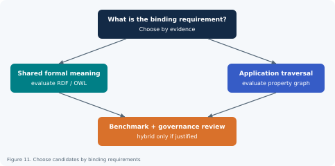

# VI · Strengths, tradeoffs, and decisions

## 6.1 Comparison: model and semantics

> **Learning goals for this part:** Compare complete candidate systems by requirement; distinguish hard requirements from weighted preferences; record an evidence-based architecture decision.

You have now seen both representations, their queries, and a mapping between them. The table below consolidates those observations by layer. Read it as a comparison of modeling choices and execution responsibilities, rather than a scorecard declaring a universal winner.

### Compare capabilities at the right layer
The table describes common strengths and modeling defaults, not an absolute limit on every implementation. A database can add features beyond its core data model, and an application can impose conventions on either approach.

| Dimension | RDF / semantic stack | Neo4j LPG / Cypher |
|---|---|---|
| Fundamental unit | Subject–predicate–object statement | Node and relationship instance with properties |
| Identifier culture | Shared IRIs are central | Application keys are central; IRIs can be retained |
| Edge attributes | Claim nodes, events, graph context, or supported annotation facilities | Relationship properties are direct and convenient |
| Formal semantics | RDFS / OWL offer standardized meaning and entailment | Domain semantics need explicit modeling and execution choices |
| Ontology usage | Natural fit for published vocabularies and reasoning | Possible through metadata, conventions, or additional tooling |
| Validation | SHACL evaluates a supplied graph | Native constraints plus domain and pipeline checks |
| Query style | Triple patterns and variable joins | Node / relationship patterns and clauses |
| Multiplicity | Identical triples form one set element | Parallel relationship instances are possible |
| Interchange | Several standardized RDF serializations | Export conventions and model mapping must be specified |
| Schema evolution | Flexible statements; semantic changes require care | Flexible graph structure; labels and properties still need governance |

### Two misleading slogans
“RDF is only for the web” is too narrow: global identifiers and shared vocabularies can help internal integration. “Property graphs have no semantics” is also too strong: domain meaning can be rigorously documented and enforced. The important distinction is whether meaning is represented through portable formal standards and whether the selected runtime executes those semantics.

A **semantic knowledge graph** often combines RDF, vocabularies, ontologies, and provenance. An LPG can also function as a knowledge graph. The choice should turn on required guarantees and workflows, not which label sounds more sophisticated.

## 6.2 Strengths and weaknesses in practice

The comparison table lists capabilities. We now connect them to practical situations: a catalog shared across independent systems, or an application that frequently records interactions and follows relationships. Each strength is useful only when it meets a requirement in that situation.

### When the semantic stack is especially useful
RDF is attractive when many sources must refer to shared entities and exchange meaning across system boundaries. Published vocabularies, formal class definitions, and standardized query patterns help when the meaning must outlive one application. Ontology reasoning can derive classifications and reveal logical conflicts. SHACL can make graph exchange contracts explicit.

The costs include a learning curve across several standards, careful namespace and identity governance, extra modeling for assertion occurrences, and implementation-dependent reasoning and transaction features. Overly expressive ontologies can be harder to understand and operate than the problem requires. RDF syntax does not automatically solve entity resolution, bad source data, or poor domain definitions.

### When the property graph approach is especially useful
An LPG is attractive when the central workload is an application following and explaining relationships, recording interactions, or calculating graph features. Cypher patterns can closely resemble the domain picture. Relationship properties make scores, timestamps, and weights straightforward when the relationship instance is the correct modeling unit.

The costs include designing durable identity and exchange conventions, governing domain meaning, and building validation beyond the selected database's native constraints. An ontology represented in the graph does not execute itself. Product-specific procedures, extensions, and operational features can increase migration effort. Simple-looking traversals can still be expensive on highly connected graphs.

### Shared obligations
Both approaches need a data contract, access controls, migration planning, benchmarks, backups, monitoring, and human ownership. Both can support recommendation and graph RAG. Both can be deployed badly. Neither guarantees reliable answers merely because relationships are explicit.

**Illustrative fit:** a course application with one owned catalog and frequent interaction updates may begin naturally with an LPG. A cross-institution course exchange with published vocabularies and classification requirements may begin naturally with RDF. These are hypotheses to validate against actual requirements, not categorical verdicts.

> A strength matters only when it satisfies a requirement. A feature that nobody uses can still impose maintenance cost.

## 6.3 A requirements-first decision framework

We can describe tradeoffs, but a project still needs a decision. This section turns the catalog's needs into a sequence of checks. Begin with conditions that cannot be compromised, then compare the candidates that satisfy them.

### Begin with hard requirements
A **hard requirement** is a condition a candidate must satisfy; a weighted score cannot compensate for failing it. Examples include required interchange formats, explicit reasoning semantics, a measured latency target, residency rules, or supported recovery procedures. A **soft preference** improves suitability without being mandatory.

Read the figure as a first branching question, not an automatic verdict. Shared formal meaning makes the semantic candidate worth evaluating; application traversal makes the LPG candidate worth evaluating. Both branches still require benchmarks and an operational review.

### Ask these questions in order
1. Which questions and transactions must the system execute? Specify outputs, volumes, update rates, and concurrency.
2. Which facts need shared identifiers and portable formal definitions? Is OWL reasoning required, or would a controlled vocabulary suffice?
3. Which rules must reject writes, which may report violations later, and which are decision policies?
4. Which deployment options meet security, recovery, skills, and budget requirements?
5. What representative prototype would disprove the preferred option?

### Make the comparison falsifiable
A **proof of concept** is a bounded experiment, not a scaled-down product launch. Give both candidates the same conceptual facts, expected answers, policy, concurrency, and resource envelope. Record any materialized inferences, denormalized shortcuts, or projections used. If one candidate includes precomputation and the other does not, report that difference.

An **architecture decision record**, or ADR, preserves context, candidates, evidence, decision, consequences, and revisit triggers. A good revisit trigger is observable: “External consumers require published SHACL shapes and stable IRIs,” or “Prerequisite query response time exceeds the service target at twice current load.” “The technology is popular” is not a sufficient decision criterion.

Section 2.8 provides the reasoning-cost checklist and contrasts an RDFS hierarchy with the richer Graduate definition. Use the worksheet in extensions/reasoning-decision to record workload evidence. A required semantics capability is a hard gate; a successful small fixture is not a measured cost justification.

## 6.4 A worked scoring matrix and ADR

The decision framework becomes clearer with a worked scenario. Assume one team owns the catalog and prioritizes an interactive recommendation service. We will score two hypothetical candidates, then write an architecture decision record that makes the assumptions and remaining tests visible.

### An illustrative application decision
Assume a small team owns the catalog, no external RDF interchange is mandatory, and the first release emphasizes interactive recommendation queries. Scores below are invented teaching values on a 1–5 suitability scale, where 5 is best. They are not benchmark results or universal product ratings.

| Criterion and weight | RDF candidate | LPG candidate |
|---|---|---|
| Application query fit · 30% | 4 | 5 |
| Team delivery readiness · 25% | 2 | 4 |
| Semantic exchange · 20% | 5 | 3 |
| Operational fit · 15% | 3 | 4 |
| Lifecycle cost · 10% | 3 | 3 |
| Weighted total | 3.45 / 5 | 4.00 / 5 |

Weighted score = sum of each criterion's weight multiplied by its suitability score. Weights sum to one. The LPG hypothesis wins under these assumptions. Raise semantic exchange to a hard requirement for formal published ontology services, and the decision process must change; a numerical total cannot override that requirement.

### Example ADR
**Context:** the application recommends courses from one controlled catalog and logs completion events. The team has experience with Cypher and needs a working service soon. Stable IDs, evidence, and export are still required.

**Decision:** prototype an LPG as the operational graph. Keep canonical IRIs and an explicit domain model. Validate title, duration, prerequisite cycles, and evidence in the ingestion pipeline. Define an RDF export contract rather than promising automatic lossless conversion.

**Evidence required before production:** identical expected query answers, target latency under representative load, retry-safe ingestion, access-control verification, and a restore exercise.

**Consequences:** application traversal is convenient, but shared ontology execution and semantic exchange need deliberate additional work. Revisit when formal inference or external RDF consumers become binding requirements.

**Sensitivity check:** change team-readiness and semantic-exchange weights. If a small change reverses the result, treat the decision as uncertain and run a more informative prototype rather than presenting the score as objective truth.

## 6.5 Explain the decision to stakeholders

The previous sections built the evidence behind a technology decision. We now practice explaining that reasoning to another person. The sample explanations show how to communicate assumptions, evidence, and limitations to stakeholders. Adapt them to actual work; they are not claims about projects you personally performed.

### A clear answer to “Why Neo4j for a recommender?”
A defensible answer ties the choice to an implemented workload: “My application needed to traverse user–item–topic relationships, record interactions with attributes, and produce understandable recommendation reasons. I selected a property graph because that model and Cypher fit those queries and the team's experience. I would verify performance with representative data rather than claim that property graphs are always faster.”

Continue with the tradeoff: “If the central requirement were cross-source semantic interoperability, published vocabularies, or formal ontology reasoning, I would evaluate an RDF stack. I would also consider a governed semantic layer with a derived application graph if both requirements justified the additional operational cost.”

### A clear answer about RDF experience
Separate practical experience from conceptual understanding. If you have not deployed RDF in production, say so directly: “My hands-on project work has been with Neo4j. I understand the RDF model and the roles of SPARQL, OWL, and SHACL, and I have worked through small examples. I would validate implementation-specific behavior in a prototype before committing to a production design.” Adapt that statement to what you have actually done.

### Explain ontology in one minute
“An ontology is an explicit domain model: its concepts, relationships, and, when formalized, logical axioms. It is not itself an algorithm. A reasoner is software that applies formal semantics. Ontologies can guide either RDF or property-graph systems, but storing ontology-like structures in a property graph does not automatically give them OWL reasoning behavior.”

### Handle the strongest follow-up
If asked “Which is best for us?”, ask for the important requirements within the discussion: shared semantics, supported queries, inference, validation, change rates, operational constraints, and existing skills. Then explain the decision framework and propose a bounded comparison. A strong answer acknowledges uncertainty while giving a concrete way to resolve it.

Avoid claims such as “RDF cannot do recommendations,” “Neo4j has no schema,” “OWL validates required fields,” or “one graph model always performs better.” Each confuses a modeling capability with implementation or policy.

### Connection to the next part
A clear explanation is only as strong as its evidence. The next part supplies the performance, recovery, governance, and security questions needed to test the proposed architecture.

### Check your understanding
**Try first:** core questions for this chapter are 1, 6, 7, 10, 12, 14, 16, 17, 20, 21. They cover its main concepts and application decision. Attempt the remaining questions as a second pass. Cover the next answer with a sheet or scroll it out of view while writing your prediction. Compare the explanation only after committing an answer.

This chapter moved from understanding the models to choosing a complete architecture. The questions below follow that decision process: identify the relevant capabilities, separate binding requirements from preferences, test candidates, and explain the result. The scoring values are teaching assumptions, not measured product ratings. Use the stated scenario rather than treating either technology as the default winner.

### Review 1 · Compare the right capabilities
**Question 1: Why is a model-comparison table insufficient to select a production database?**

**Answer:** A data model describes representation, while a working system also depends on its implementation, configuration, reasoning support, validation workflow, and operations. Two RDF implementations can have different operational characteristics, and different Neo4j versions or editions can expose different features. Use the table to identify relevant questions, then evaluate concrete candidate stacks against the workload and required guarantees.

**Question 2: Is RDF useful only when data is publicly published on the web?**

**Answer:** No. Shared identifiers, vocabularies, and formal definitions can also support internal integration across independent systems. A public web application is not a prerequisite for those needs. The relevant question is whether the project benefits from those identity and semantic conventions and can govern them effectively, rather than whether its users browse the graph through a website.

**Question 3: Does choosing an LPG mean abandoning semantics or an ontology?**

**Answer:** No. A property-graph application can have precise domain definitions, ontology-guided modeling, and explicit validation and reasoning components. What it does not gain automatically is OWL execution from node labels or ontology-shaped records. Compare how each candidate represents meaning and which component actually applies it. Documented meaning and standardized executable semantics are related but distinct requirements.

**Question 4: When does the semantic stack have a particularly strong fit, and what work remains?**

**Answer:** It is especially worth evaluating when independent sources need shared identities, published vocabularies, formal classification, and explicit exchange contracts. RDF, RDFS/OWL, and SHACL provide relevant standardized building blocks. The team still needs entity resolution, suitable definitions, namespace governance, implementation selection, and operational testing. Standards make parts of the contract portable; they do not make inaccurate source records or ambiguous terms disappear.

**Question 5: When does an LPG have a particularly strong fit, and what work remains?**

**Answer:** It is especially worth evaluating for applications centered on relationship traversal, interaction records, and explainable graph patterns. Relationship properties can be convenient when the relationship instance is the right modeling unit. Durable identity, exchange mappings, domain validation, access control, and migration policies still need deliberate design. A readable Cypher query does not establish good performance on a highly connected production graph.

### Review 2 · Separate binding conditions from preferences
**Question 6: May a high weighted score compensate for a failed hard requirement?**

**Answer:** No. A hard requirement is a condition of acceptability. A candidate that fails it should not win through strengths in unrelated preference categories. First establish which candidates meet every binding condition, then compare their preferences. If no candidate qualifies, investigate a different architecture or seek an explicit revision of the requirement; do not hide the failure inside an average score.

**Question 7: How can a vague goal such as “the recommender must be fast” become a testable requirement?**

**Answer:** Specify the relevant query or transaction, representative data and update conditions, concurrency, resource envelope, and an acceptance threshold. State how the measurement will be taken and what counts as failure. “Fast” alone leaves different readers imagining different workloads. A measured latency requirement becomes a hard gate only when its scope and acceptance conditions are defined and binding.

**Question 8: If RDF export is mandatory, does that automatically rule out an application-primary LPG?**

**Answer:** No. A candidate can include a governed RDF export if it satisfies the required identifiers, vocabularies, values, context, and delivery contract. That is different from requiring a live service with specified formal inference or query semantics. Identify the exact obligation, then test the whole candidate architecture. Do not confuse requiring an output format with requiring every operational fact to be stored natively in that format.

**Question 9: Is a controlled topic vocabulary always a reason to adopt a rich OWL ontology?**

**Answer:** No. Determine what the competency questions require. A controlled vocabulary or lightweight concept organization may be sufficient for agreed topic terms and navigation. Richer OWL commitments become relevant when the required answers depend on their formal consequences. Extra expressiveness can add modeling and operational costs without improving the application if nobody needs those consequences.

### Review 3 · Use scoring as a transparent aid
**Question 10: How is the RDF candidate's illustrative score of 3.45 calculated?**

**Answer:** Multiply each suitability score by its weight and add the contributions: 0.30 × 4 + 0.25 × 2 + 0.20 × 5 + 0.15 × 3 + 0.10 × 3 = 3.45. The weights sum to one, so the result remains on the stated 1–5 scale. The calculation is reproducible arithmetic; the chosen scores and weights remain assumptions that need justification.

**Question 11: What does the LPG candidate's score of 4.00 establish, and what does it not establish?**

**Answer:** It establishes that the LPG candidate scores higher under this example's weights and assigned suitability values. It does not establish measured superiority, a universal ranking, or production readiness. The scenario assumes one owned catalog, relevant team experience, and no mandatory external RDF interchange. Changing those conditions can change which candidate is appropriate even when the arithmetic is correct.

**Question 12: What is a sensitivity check, and why does a narrowly winning score call for caution?**

**Answer:** A sensitivity check changes plausible assumptions, such as weights or uncertain suitability scores, and observes whether the decision changes. If small plausible adjustments reverse the ranking, the evidence does not strongly separate the candidates. Identify the uncertain criterion that matters most and design a more informative prototype. Adding decimal places to the total does not make uncertain judgments more accurate.

**Question 13: Can team familiarity count in the comparison, or is it irrelevant to architecture?**

**Answer:** It can matter because delivery time, support capacity, and maintenance depend on available skills. Record it as a contextual criterion rather than treating familiar syntax as proof of better semantics or performance. If training, hiring, or operational support can change the situation, include those costs and options. A decision for one team need not be the right decision for another.

### Review 4 · Design evidence that could change the decision
**Question 14: What makes a proof of concept informative rather than a demonstration of the preferred tool?**

**Answer:** It tests a bounded uncertainty with declared acceptance conditions and a result that could disprove the preferred option. Give candidates equivalent conceptual facts, expected answers, policy, and representative operating conditions. Select cases that challenge correctness and operational fit, not only the easiest graph pattern. A successful small experiment supports only the claims it actually tested; it is not a scaled-down production approval.

**Question 15: Is a comparison fair if one candidate precomputes inferences and the other recomputes them for every query?**

**Answer:** The designs can be compared, but that difference must be explicit. Precomputation can trade faster reads for storage, ingestion work, and update or refresh costs. Report those costs and ensure the candidates provide equivalent answers and acceptable freshness. Comparing only query latency while concealing different preparation and maintenance work can produce a misleading conclusion.

**Question 16: Why should the team test expected answers before treating a faster result as a success?**

**Answer:** A query that omits a prerequisite condition or reads a stale projection can be fast while answering a different question. Establish semantic equivalence through expected outputs, counterexamples, and the same completeness assumptions. Then measure performance under the declared workload. Correctness is part of the acceptance contract, not a preference that response speed can compensate for.

### Review 5 · Record and communicate the decision
**Question 17: What belongs in an architecture decision record, and what makes a useful revisit trigger?**

**Answer:** Record the context, requirements, candidates, evidence, decision, consequences, and conditions for revisiting it. A useful trigger is observable, such as external consumers requiring a specific ontology service or a prerequisite query breaching its target at a stated load. “Reconsider someday” gives no clear action point. The ADR should let another reader understand both why the choice was reasonable and when its assumptions stop holding.

**Question 18: If an LPG is selected for the catalog, which semantic and operational responsibilities remain?**

**Answer:** Stable identifiers, domain definitions, validation, evidence, and a tested exchange contract remain necessary. The example also requires representative latency measurements, retry-safe ingestion, access-control verification, and a restore exercise before production. Choosing an operational graph does not remove those obligations or establish that they are already complete. Record the owners and remaining evidence rather than presenting the selection itself as validation.

**Question 19: How should someone explain a Neo4j choice or limited RDF experience without making unsupported claims?**

**Answer:** Connect the choice to the actual workload, modeling needs, team skills, and evidence gathered, then explain the tradeoffs and conditions that would favor an RDF stack. Separate hands-on implementation experience from conceptual understanding and tutorial exercises. Do not borrow the chapter's sample wording as a claim of work never performed. A credible answer can acknowledge a limitation while proposing a concrete prototype to resolve the remaining uncertainty.

### Apply the framework to a changed requirement
**Question 20: The LPG candidate leads the weighted table, but a new binding requirement demands a service with specified formal ontology reasoning. What should happen next?**

**Answer:** Reopen the hard-requirement assessment for complete candidate architectures. Determine exactly which semantics, interfaces, and correctness guarantees are required, then verify whether each stack, including any additional reasoning component, can provide them. Exclude candidates that cannot qualify; do not preserve the old winner merely because its total was higher. If a hybrid design is proposed, include mapping fidelity, synchronization, freshness, and operating cost in its assessment. Update the ADR with the changed requirement, evidence, and remaining tests.

**Question 21: One candidate answers a small hierarchy query faster but omits a required ontology consequence. May it win the weighted score?**

**Answer:** Not while that consequence is a mandatory requirement. First reject or repair candidates that fail the required answers; then compare the costs of adequate designs. Record query and update behavior, inference maintenance and operational effort. Revisit the requirement if the business accepts a different scope, rather than silently scoring an incorrect answer as a speed advantage.

**Ready to continue:** You should be able to distinguish a model capability from an implemented guarantee, apply hard gates before preference scoring, explain the limits of the worked matrix, and propose evidence that could change a decision. The next part turns the operational requirements into concrete performance, recovery, governance, and security questions.

