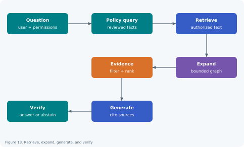

# VIII · Graph RAG and analytics

## 8.1 What graph RAG adds to retrieval

> **Learning goals for this part:** Explain where a graph helps retrieval; separate reviewed facts from extracted claims; evaluate evidence and permission failures; distinguish prediction from eligibility.

We now add a new user interface to the catalog: a person asks a question in ordinary language and expects an evidence-backed answer. This section introduces retrieval-augmented generation, then explains where the graph can contribute to answering “What can Maya study next, and why?”

### Start with the new user need
Until now, a fixed query has returned course records. Imagine instead that a user asks in everyday language, “Why is Graph Search an eligible next course for Maya under the catalog policy?” The system must find both the structured eligibility facts and readable source passages, then compose an explanation supported by that evidence. If the user instead asks whether it is personally suitable, the answer must identify the additional assessment evidence required rather than silently broaden the policy result. This motivates the retrieval-and-generation approach introduced below.

### Start with ordinary RAG
**Retrieval-augmented generation**, or RAG, supplies retrieved evidence to a language model before it generates an answer. A **large language model**, LLM, predicts and generates text; it is not an authoritative database. A **chunk** is a selected span of source content. An **embedding** represents content as a numeric vector so that a similarity function can compare representations.

**Vector retrieval** finds items with nearby embeddings. It can retrieve a course description that sounds relevant while missing a crucial prerequisite. **Graph RAG** uses graph structure during evidence organization, retrieval, expansion, or summarization. It is a family of designs, not one standardized algorithm and not a capability reserved for one graph model.

Read the figure from the question to the structured policy query, then retrieve candidate text, expand relevant graph connections, filter and rank evidence, generate an answer, and verify it. Each box is a pipeline responsibility; neither RDF nor Neo4j supplies the complete pipeline merely by storing a graph.



### A question that benefits from structure
“Which graph course can Maya take next, and why?” requires identity resolution, topic preferences, completions, prerequisites, and current course descriptions. A document-only answer may overlook a missing prerequisite. A graph-only answer may lack explanatory text from the source. A combined pipeline can use structured eligibility and retrieve supporting passages for the explanation.

A **retriever** selects candidate evidence. A **reranker** reorders candidates using a more focused scoring method. **Grounding** ties generated statements to supplied evidence. A **citation** identifies the source supporting a statement. A source link alone does not demonstrate that the cited passage actually supports the claim.

### Local and global questions
Local retrieval starts from entities and explores a relevant neighborhood. Global questions may require summaries across communities or large portions of a corpus. Here a community is a group of densely connected entities under a chosen graph view; a community summary condenses source material associated with that group. It is still derived text to evaluate, not an authoritative catalog rule. A published graph RAG approach uses graph-derived community summaries for query-focused summarization; that is a specific design within the wider family. [[30](xii-references.md#ref30)]

## 8.2 Build evidence before generating answers

The previous section described the answering flow. Before that flow can work, source documents must become reliable, permission-aware evidence. We now extend the catalog with document records and extracted candidate claims, keeping them distinct from reviewed prerequisites and completions.

### A governed indexing pipeline
1. Register each source document with a stable ID, version, access policy, and publication time.
2. Split content into chunks while preserving document IDs and span locators.
3. Extract candidate entities and claims with evidence spans; mark extracted content as unreviewed when appropriate.
4. Resolve entities against canonical IDs and validate claims against the domain contract. Keep unresolved mentions local; do not force a title match into an identity merge.
5. Store structured relationships, evidence links, and searchable text or embeddings.
6. Publish a versioned retrieval view after quality and access checks.

### Extraction is not assertion of truth
**Information extraction** converts text into structured candidates. **Entity linking** connects a mention in text to a known entity. **Relation extraction** proposes relationships between entities. A model might confuse a course that discusses prerequisites with a course that requires another course. Retain the source sentence and allow review rather than silently treating every extracted edge as authoritative.

Use a **claim node** when a statement can be disputed, time-bound, or supported by multiple documents. A claim can have a status such as candidate, reviewed, rejected, or superseded. Keep conflicting claims if provenance is important, while defining which statuses the decision engine is allowed to use.

Section 5.2 distinguishes mention spans, within-document aliases, cross-document identity, predicate mapping and evidence retention. Its same-title/different-edition counterexample applies before graph expansion: an incorrect merge can retrieve a perfectly cited passage about the wrong course. Count repeated support separately from independently assessed corroboration.

### Choose a source of truth for eligibility
The catalog's reviewed prerequisite field should control eligibility, not whichever wording ranks highest in vector search. Retrieval can help find explanations and discover candidate facts, but it must not bypass the policy. In RDF, use explicit graph scopes for reviewed assertions. In an LPG, use governed relationship sets or claim-status filters. In either case, graph access must respect the user's permissions.

A **knowledge-graph construction pipeline** is a series of parsing, extraction, linking, validation, and publication steps. A toolkit can automate parts of this pipeline, but its defaults do not replace domain decisions about identity, evidence, or confidence. Implementation documentation should be checked for exact supported database versions and retriever behavior. [[31](xii-references.md#ref31)]

> Store the evidence span with the claim. An attractive graph without traceable evidence is a difficult system to debug.

## 8.3 A retrieval plan for the running example

Assume the evidence pipeline has published reviewed, authorized catalog data and source passages. We can now trace one answer from Maya's question to candidate courses and supporting evidence. The block below is architecture pseudocode, not Cypher, SPARQL, or runnable Python.

### Keep structured policy and explanatory text coordinated
The following is architecture pseudocode. It is intentionally independent of database drivers and vector-index APIs, whose syntax and filtering support vary by release.

**Architecture pseudocode — one answering request.** Read each line as a responsibility to implement. Named functions are explanatory placeholders, and the hop and token limits are illustrative settings.

```text
answer(question, user_context):
    identity = resolve_authorized_subject(question, user_context)
    scope = authorized_catalog_snapshot(user_context)
    candidates = query_eligible_courses(identity, scope)
    seeds = retrieve_text(question, scope, limit=20)
    evidence = expand_from_candidates(
        candidates, seeds, allowed_relations, max_hops=2)
    evidence = filter_permissions_and_freshness(evidence)
    evidence = rank_and_limit(evidence, token_budget=4000)
    if missing_required_evidence(evidence):
        return abstain_with_reason()
    draft = generate_from_evidence(question, candidates, evidence)
    return verify_support_and_citations(draft, evidence)
```

A **token budget** limits the amount of model input or output. A **seed entity** is a starting point for graph expansion. An **allowlist** names permitted relation types or tools. A **freshness policy** defines which versions or timestamps are acceptable. **Abstention** is an explicit choice not to answer when required evidence is missing.

### Abstain from an unsupported claim
Claim scope matters. The catalog evidence can support “c2 meets the recorded prerequisite policy” while leaving “c2 fits Maya's current demands” unassessed. Separate missing assessment evidence from evidence of a negative outcome. Define the evidence requirement and how it is evaluated before enabling the broader claim; provenance, inference and validation cannot recover a relevant observation never collected. An answer may offer the limited candidate and ask for context while declining to assert suitability.

### Trace one answer
For this walk-through, assume that evidence document d2 has now been registered and contains a reviewed description of c2, while d1 supports completion event e1. These document records belong to the evidence extension, not the original baseline. The eligibility query returns c2. Expansion gathers its Graphs topic, its c1 prerequisite, Maya's qualifying completion event, and d2's course description. The generator receives only authorized evidence. It explains the recommendation and cites the passage supporting the course description and the record supporting completion, with appropriate user-facing locators.

### Why a bounded neighborhood matters
Expanding every reachable edge can mix irrelevant topics, leak information, and exhaust the context window. A two-hop bound is illustrative, not a universal optimum. Measure whether it retrieves the required evidence for each question class. A global summary question may need a different retrieval route rather than a larger local radius.

Do not make text-to-query generation the only route for a known policy. A fixed, parameterized eligibility query is easier to validate than arbitrary generated logic. If generated queries are allowed, inspect and restrict their structure before execution.

## 8.4 Evaluate graph RAG by failure mode

The retrieval plan explains the intended behavior. We now test whether the system actually retrieves the right evidence, respects permissions, and supports what it says. The evaluation compares system variants; it does not assume that adding a graph improves every question.

### Separate retrieval, reasoning, and writing quality
An answer may sound fluent while using the wrong learner, omitting a prerequisite, or citing an unrelated passage. Evaluate each stage separately. Compare at least a text-only retrieval baseline, a structured-query baseline where applicable, and a hybrid graph pipeline using the same question set and access policy.

The table separates the questions to test. In “recall at k,” **k** is the number of retrieved items inspected; for example, recall at 10 checks whether the required evidence appears among the first ten items. Precision asks how much of what was retrieved is useful.

| Metric / check | What it reveals |
|---|---|
| Entity-link accuracy | Whether mentions resolve to the right canonical resources |
| Evidence recall at k | Whether required evidence is present among the first k items |
| Evidence precision | How much retrieved material is relevant and usable |
| Eligibility accuracy | Whether structured policy outcomes match reviewed answers |
| Citation support | Whether cited passages support each generated claim |
| Abstention quality | Whether the system declines when evidence is insufficient |
| Permission isolation | Whether any hidden content or derived fact is exposed |
| Cost and latency | Whether the pipeline meets practical service limits |

### Build adversarial examples
Include similarly named courses, missing completion evidence, conflicting prerequisite descriptions, retired editions, stale documents, unauthorized learner records, and text containing malicious instructions. Include questions with no supported answer. A benchmark with only answerable questions encourages overconfident generation.

**Ablation** removes one component to measure its contribution. Remove graph expansion while keeping retrieval and model settings fixed. Remove reranking. Compare reviewed assertions with unrestricted extracted claims. If graph expansion adds cost without improving the relevant outcomes, simplify the pipeline.

### Distinguish similarity from support
Embedding similarity indicates a relationship in a representation space, not factual entailment. A high similarity score is not a calibrated probability that a claim is true. Graph adjacency also does not prove support: ABOUT and REQUIRES carry different meanings. Preserve relation semantics during retrieval and explanation.

A graph can reduce some retrieval failures by exposing structure, but it does not eliminate hallucination or guarantee causal reasoning. Quality depends on extraction, identity, evidence, policies, retrieval, and generation together. Use this evaluation plan as a system design proposal, not as an empirical claim that one graph approach always produces better answers.

## 8.5 Graph algorithms and learned representations

Graph RAG uses relationships to find evidence, but a graph can also support analytics and learned recommendation scores. We now distinguish those tools from the rule-based eligibility query. A predicted interest can help rank c2; it cannot silently redefine whether Maya completed c1.

### Different tools answer different questions
A **graph algorithm** computes a structural property or solution over a graph. A **graph embedding** assigns vectors to nodes or graphs using structure, attributes, or both. A **graph neural network**, GNN, learns representations by combining information from connected entities according to a model architecture. These are distinct from OWL reasoning and from ordinary graph queries.

| Technique | Typical question | Limitation to remember |
|---|---|---|
| Connected components | Which nodes are connected in a selected relation view? | Connectivity does not imply similarity or identity |
| Centrality | Which nodes are structurally prominent? | Popularity can reflect bias or data collection |
| Community detection | Which groups are densely connected? | Communities depend on algorithm and graph projection |
| Similarity / embeddings | Which courses or learners look alike? | Similarity is not eligibility or semantic equivalence |
| Link prediction | Which relationship may occur next? | Prediction is not a verified fact |
| Shortest path | What route minimizes hops or cost? | A short path need not be a valid learning plan |

A **graph projection** for analytics selects labels, relationships, directions, and weights from operational data. A graph data science engine can run algorithms on that projection. Exact algorithms, memory requirements, and execution features depend on the selected engine. [[32](xii-references.md#ref32)]

### Use predictions after hard rules
A recommender can predict interest in c3 and still exclude it if prerequisites are unmet. A ranking model should not redefine “completed.” Keep learned scores separate from reviewed facts. Track model versions and evaluation data so that a recommendation is reproducible.

**Data leakage** occurs when information unavailable at prediction time enters training or evaluation. For temporal recommendations, split by time and prevent future completions from influencing past predictions. **Cold start** describes limited evidence for a new user or item. Topics and ontology structure can provide useful features, but their usefulness must be evaluated rather than assumed.

### Connection to the next part
These techniques broaden what the graph can do, but their outputs still depend on the definitions and evidence introduced earlier. The next part revisits the ideas through mistakes, controlled exercises, and contrasting project scenarios.

### Check your understanding
**Try first:** core questions for this chapter are 1, 2, 6, 8, 10, 11, 13, 16, 22, 23, 24, 25. They cover its main concepts and application decision. Attempt the remaining questions as a second pass. Cover the next answer with a sheet or scroll it out of view while writing your prediction. Compare the explanation only after committing an answer.

This chapter added retrieval, generation, and analytics to the catalog; it did not replace the reviewed eligibility policy. The questions follow an answer from source indexing through retrieval and verification, then distinguish learned recommendations from verified facts. Document records such as d1 and d2 belong to the evidence extension, not the original baseline. Predict what the system should do before reading each answer.

### Review 1 · Identify the job of each component
**Question 1: What does ordinary RAG add to a language model, and what makes a design graph RAG?**

**Answer:** Ordinary retrieval-augmented generation supplies retrieved material as context before a model generates an answer. Graph RAG uses graph structure in organizing, retrieving, expanding, or summarizing that evidence. It is a family of designs rather than one standard algorithm. Neither RDF nor an LPG supplies a complete answering pipeline simply by storing connections; retrieval, access checks, generation, and verification still need implementation.

**Question 2: Why can a relevant course description be insufficient to answer “What can Maya study next?”**

**Answer:** The description may discuss Graphs without establishing whether Maya has completed the course or satisfied its prerequisites. Eligibility requires the structured policy and relevant reviewed records. Retrieved prose can explain the course, while completions and prerequisites establish the policy result. A fluent answer based only on a top-ranked description can miss a decisive unmet requirement.

**Question 3: How do a retriever, a reranker, grounding, and a citation differ?**

**Answer:** A retriever selects candidate material; a reranker changes the order of those candidates using another scoring method. Grounding ties generated claims to supplied evidence. A citation identifies a supporting source or location. A reranker score is not itself evidence, and a citation is useful only if its referenced content actually supports the claim. Evaluate those responsibilities separately rather than treating one source link as proof of the whole answer.

**Question 4: Should a global question about the catalog always use a larger local neighborhood?**

**Answer:** No. Local retrieval starts from selected entities and nearby connections. A global question can require coverage or summaries across many communities or a larger corpus. Increasing a local hop radius can add noise and cost without supplying representative coverage. Choose and evaluate the retrieval route for the question class; the example's two-hop setting is an illustration, not a universal optimum.

### Review 2 · Prepare trustworthy, authorized evidence
**Question 5: What must remain attached to a chunk when a source document is split?**

**Answer:** Retain its document identity, version, location within the source, and applicable access information. Those links let the system trace a retrieved passage back to the exact source and apply the relevant permissions and freshness policy. Detached text may sound useful while being impossible to verify or unsafe to disclose. Chunking is a preparation step, not permission to discard source context.

**Question 6: Why is extracting a relation different from accepting it as a reviewed fact?**

**Answer:** Extraction proposes a structured interpretation of text. It can confuse a course that discusses prerequisites with a course that requires another course. Preserve the supporting span, resolve the entity identities, validate the proposed relation, and apply the declared review process. A syntactically valid edge can still have the wrong meaning. Candidate claims should not silently enter the relationship set used for eligibility.

**Question 7: Two course editions share a similar title. Why must entity linking be checked before graph expansion?**

**Answer:** Expansion from the wrong edition can retrieve internally connected but irrelevant prerequisites, completions, and descriptions. More hops then amplify the identity mistake rather than correct it. Link the mention to the intended canonical resource using appropriate evidence and context, and handle unresolved ambiguity explicitly. Accurate retrieval depends on starting from the correct entity, not merely a similarly named one.

**Question 8: Does a retrieved or predicted edge automatically qualify as evidence for eligibility?**

**Answer:** No. Check the relationship's meaning, source provenance, review status, freshness, permissions, and permitted policy role. An ABOUT edge is not a REQUIRES edge; a predicted COMPLETED edge is not a verified completion. A source can be relevant without being authoritative for the decision. The application must specify which reviewed facts and evidence are allowed to establish eligibility.

**Question 9: What should happen when a highly ranked passage conflicts with the reviewed prerequisite record?**

**Answer:** Ranking alone should not override the designated source of truth. Preserve the conflicting claim and its evidence for review, and follow the declared authority and conflict policy. If the conflict undermines required evidence, withhold the affected conclusion or qualify it as the policy requires. Do not let a generator silently reconcile incompatible facts by selecting whichever wording sounds more convincing.

**Question 10: Why must permissions apply to graph expansion and generated summaries as well as retrieved documents?**

**Answer:** A hidden completion record or relationship can reveal sensitive information even if the original document is never displayed. Summaries and generated explanations can disclose facts derived from restricted sources. Apply authorization to the subject, graph scope, evidence, and outputs throughout the request. A final document-link filter cannot repair information already exposed to an unauthorized generation context or answer.

### Review 3 · Follow and constrain one answering request
**Question 11: Why compute eligible courses with a known policy query before asking the generator to explain the result?**

**Answer:** It keeps the decision tied to explicit, testable conditions rather than improvised generated logic. The generator can describe the eligible candidates using authorized supporting material without redefining completion or prerequisites. For Maya, the baseline policy returns c2; the evidence extension then supplies the completion support and course description. The chapter's pseudocode names these responsibilities but is not a runnable driver or a completed service.

**Question 12: What does bounding hops and tokens accomplish, and what does it not guarantee?**

**Answer:** Bounds limit graph expansion and the amount of material passed to the model, helping control cost, latency, and irrelevant context. They do not guarantee that the necessary evidence is included or that all included facts are relevant and authorized. Test whether each question class retains its required evidence under the chosen limits. If a bound removes a decisive prerequisite, revise the plan rather than accepting an incomplete explanation.

**Question 13: When should the pipeline abstain, and why is abstention not the same as answering “not eligible”?**

**Answer:** Abstain when evidence required for the requested conclusion is missing, inaccessible, stale, or otherwise insufficient under the policy. “Not eligible” is a policy result supported by the required inputs, such as a known unmet prerequisite. “Insufficient evidence to determine eligibility” describes a limitation in what can be established. Keeping those outcomes separate prevents a retrieval failure from being presented as a negative fact about the learner.

**Question 14: Why does a generated answer with citations still need verification?**

**Answer:** The cited passage may be unrelated, refer to a different edition, or support only part of a sentence. Check the answer's claims against the actual authorized evidence and confirm that the locators identify the intended source versions. For a recommendation, check the structured eligibility result too. A citation's presence establishes that a reference was produced, not that the explanation is accurate or complete.

**Question 15: Why restrict generated queries instead of executing any query a model proposes?**

**Answer:** A proposed query can read unauthorized records, change data, request expensive expansions, or implement the wrong policy. Prefer a validated parameterized query for a known eligibility task. Where generated queries are needed, restrict their structure, operations, and resource use before execution, under the application's access controls. Instructions found inside retrieved text are source content, not authority to change those execution rules.

### Review 4 · Evaluate failures and useful contributions
**Question 16: How can evidence recall, evidence precision, and citation support disagree?**

**Answer:** Recall measures how much required evidence was retrieved; precision measures how much retrieved material is relevant and usable. A result set can include every required item but also contain much irrelevant text. Citation support asks whether the answer's cited content actually supports its claims; a generator can cite the wrong passage even when the right evidence was retrieved. Improving one measure does not automatically fix the others.

**Question 17: Why compare text-only, structured-query, and hybrid baselines on the same questions?**

**Answer:** They show which tasks benefit from graph structure and what additional cost it introduces. A structured query may already answer a precise eligibility question, while prose retrieval supplies descriptive support and a hybrid combines them. Keep the question set and access policy comparable. A graph pipeline should earn its complexity through relevant improvements, not through a comparison against an artificially weak alternative.

**Question 18: What is an ablation, and which difficult cases belong in this evaluation?**

**Answer:** An ablation removes a component, such as expansion or reranking, while holding other relevant settings fixed to examine its contribution. Include ambiguous names, conflicting prerequisites, stale or missing completion evidence, restricted records, malicious source instructions, and questions without a supported answer. Also measure latency and cost. A test set containing only easy, answerable questions cannot reveal whether the pipeline abstains or respects boundaries when it matters.

### Review 5 · Keep analytics separate from authoritative facts
**Question 19: Does embedding similarity, centrality, or community membership establish identity or eligibility?**

**Answer:** No. Embeddings express similarity in a chosen representation; centrality measures a form of structural prominence; community detection groups nodes under an algorithm and graph view. Their outputs can be useful features or retrieval signals without proving identity, prerequisite satisfaction, or truth. A high similarity score is not automatically a calibrated probability that a claim is correct. Preserve the distinction between those signals and reviewed records.

**Question 20: What distinguishes a graph query, OWL reasoning, and a GNN prediction?**

**Answer:** A graph query retrieves or computes results according to its patterns and operations. OWL reasoning derives logical consequences under selected formal semantics. A graph neural network learns representations using connected information according to its architecture and training. These mechanisms answer different questions. A learned likely completion is not the same as a recorded completion or a logically entailed fact, even if all three outputs are represented as edges.

**Question 21: Why record an analytics projection and prevent temporal data leakage?**

**Answer:** The projection selects the nodes, relationship types, directions, and weights available to the algorithm, so it helps define what the result means. Temporal leakage occurs if information unavailable at the prediction time, such as a future completion, enters training features or evaluation inputs. Record data and model versions and split by time appropriately. Apparent accuracy based on future knowledge is not evidence of a deployable recommender.

**Question 22: Can ontology topics solve cold start, and should a high predicted interest override an unmet prerequisite?**

**Answer:** Topics and domain structure can provide features when a new learner or course has little interaction history, but their usefulness requires evaluation. That potential benefit does not make an uncertain preference prediction authoritative. Use reviewed hard rules to determine eligibility, then apply learned scores to rank qualifying candidates under the stated policy. A high predicted interest cannot supply a missing completion record.

### Apply the chapter to an attractive but unsupported answer
**Question 23: The retriever finds an excellent description of c2, a model predicts that Maya completed its new prerequisite, and the only supporting completion document is unauthorized. May the answer recommend c2 as eligible?**

**Answer:** Not on that basis. The description supports course content, not prerequisite completion; the predicted edge is not a verified completion; and restricted evidence cannot be used outside its authorized scope. Evaluate the policy against the permitted reviewed data. If required evidence is insufficient, return the appropriate limited or abstaining result without revealing the restricted record. If authorized policy inputs establish an unmet prerequisite, report that outcome accurately. Fluency and high relevance scores cannot compensate for missing authority or evidence.

### Review 6 · Preserve the limits of the answer
**Question 24: May a generated explanation call c2 personally suitable merely because the catalog query returns it?**

**Answer:** No. Explain the recorded eligibility result and disclose that suitability is not assessed unless the additional criteria and evidence have been defined and evaluated. Withhold the unsupported suitability claim while offering the limited candidate or requesting context. Missing evidence is not a negative suitability finding.

**Question 25: Five passages have the same title and support a requires edge. What must be checked before using them?**

**Answer:** Check which provider and edition each passage concerns, whether the edge direction and meaning match the intended predicate, and whether the passages share an underlying source. Preserve source versions and locators. A count does not establish independent corroboration, and a citation to a different course does not support the requested claim.

**Ready to continue:** You should be able to trace a supported answer, identify where extraction and prediction remain uncertain, explain permission and freshness boundaries, and design checks for the pipeline's actual failure modes. Chapter 9 now applies these distinctions through mistakes, guided exercises, and architecture cases.

